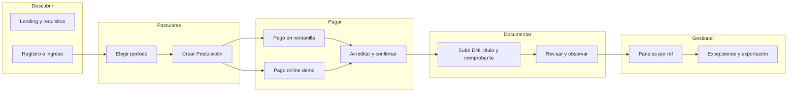
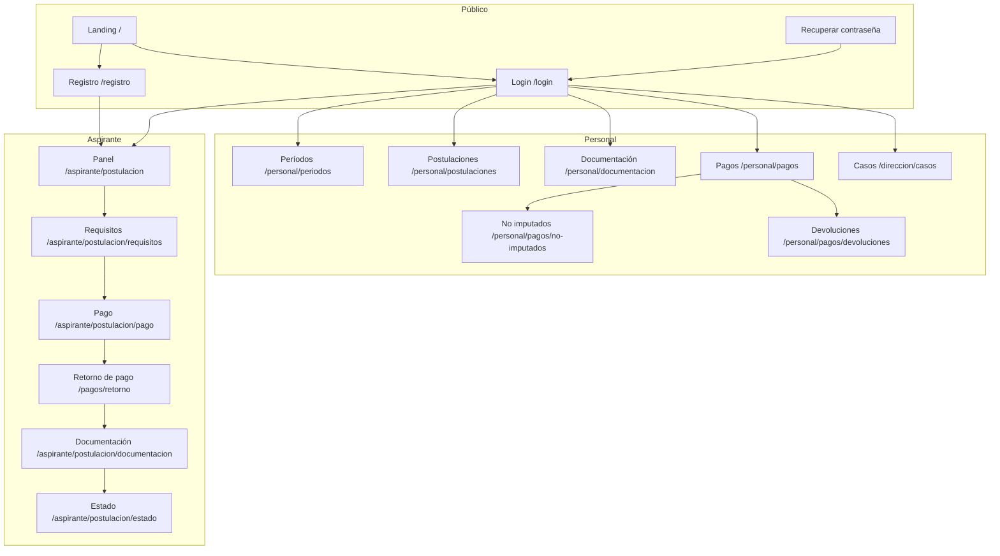
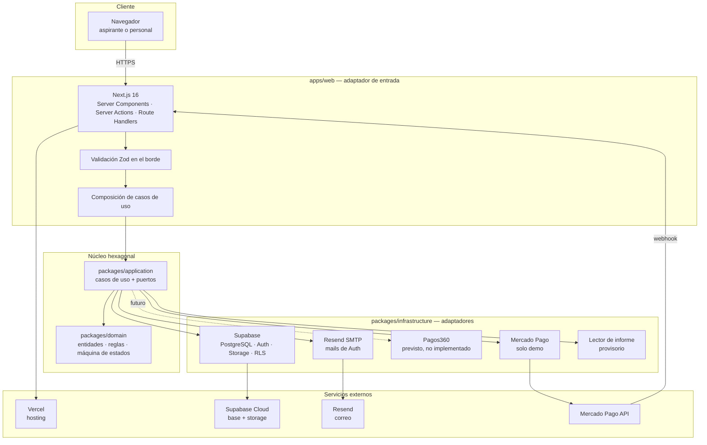
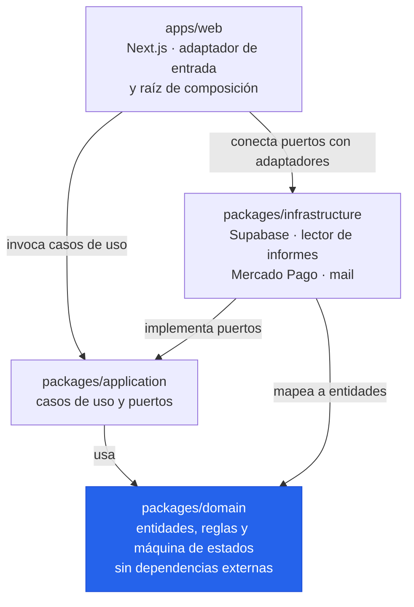
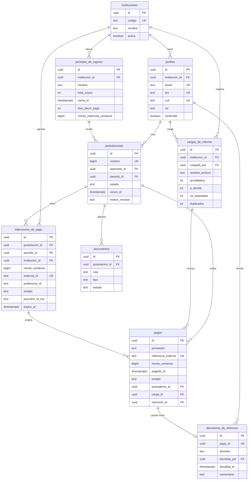
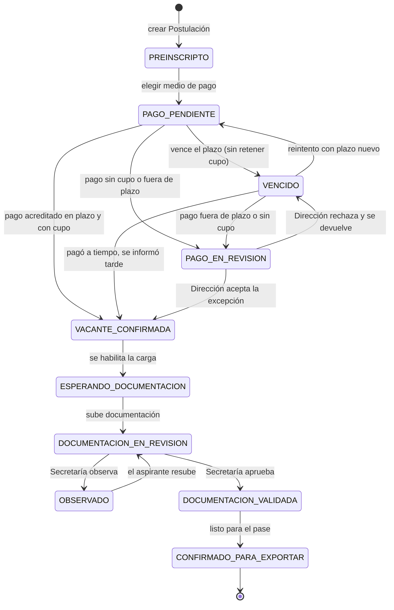
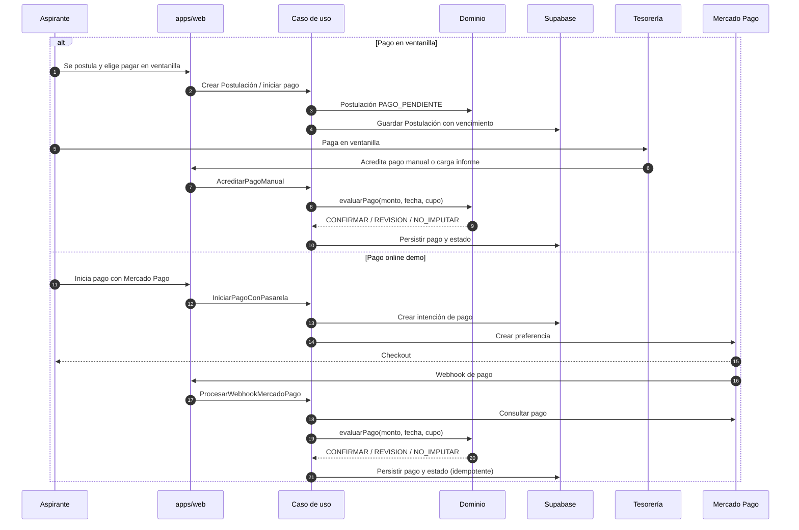
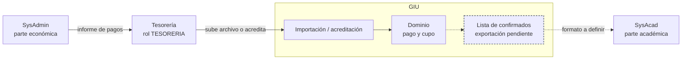

# Universidad Tecnológica Nacional

## Cátedra Práctica Profesional Supervisada — Año 2026

# Proyecto: GIU — Gestión de Ingresantes Universitarios

**Producto:** GIU (Gestión de Ingresantes Universitarios)

**Dominio:** `sistemagiu.com.ar`

**Estado:** MVP funcional en entorno de demostración. No está en producción institucional.

**Número de Equipo:** 5

**Versión del documento:** 1.0 — 04/11/2026

> **Cómo leer este documento.** Es una foto del proyecto al 04/11/2026, no una promesa de lo que
> podría llegar a ser. Cada afirmación técnica se puede rastrear en el repositorio: el código de
> `develop`, las migraciones, los ADR, la spec 001 y la salida de las pruebas. Cuando algo está
> diseñado pero todavía no funciona, se dice explícitamente. Esa distinción es parte de la entrega.

## Integrantes Equipo de Proyecto

| DNI      | Nombre                       | E-Mail                                    |
| -------- | ---------------------------- | ----------------------------------------- |
| 47214815 | De Vivo Federico             | Fdevivo096@alumnos.frh.utn.edu.ar         |
| 44886849 | Vadone Santiago Gabriel      | svadone373@alumnos.frh.utn.edu.ar         |
| 40290828 | Enriquez Aveiro Lucia Este   | lenriquez551@alumnos.frh.utn.edu.ar       |
| 32384844 | Tschernitschek Sergio Fabian | stschernitschek377@alumnos.frh.utn.edu.ar |

**Docente:** Lic. Leila Coronel

---

## Resumen ejecutivo

GIU digitaliza el ingreso a la Tecnicatura Universitaria en Programación de la UTN Facultad
Regional Haedo. La regla que ordena todo el sistema la definió el Director de la carrera: **el pago
acreditado es la única reserva de vacante; la documentación se revisa después**. Hoy el proceso se
sostiene con un formulario, un Drive, un Excel, correos sueltos y una carga manual en SysAcad. GIU
reemplaza esa cadena por un único punto de verdad, con estados, plazos, cupos y trazabilidad.

Al cierre de este documento el producto está **funcional y demostrable**: se puede registrar un
aspirante, postularse a un período, pagar en ventanilla o con Mercado Pago en modo demo, confirmar
la vacante, cargar documentación, revisarla desde Secretaría y resolver excepciones desde Dirección.
También están los paneles por rol, la recuperación de contraseña y la landing institucional.

Lo que **no** está terminado, y el documento lo marca sin vueltas:

- La puesta en producción institucional: falta la autorización de la facultad para alojar datos
  personales y definir el circuito formal de publicación.
- La integración con Pagos360. Mercado Pago está solo como excepción temporal de demo, detrás del
  puerto `PasarelaDePago` y con `PAGOS_PASARELA=mercadopago`. En producción la configuración prevista
  es `PAGOS_PASARELA=off` hasta que exista la pasarela institucional.
- La exportación a SysAcad. El estado `CONFIRMADO_PARA_EXPORTAR` existe en el modelo, pero el
  exportador con el formato real todavía no.
- La operación simultánea de varias carreras. El esquema está preparado para multi-institución; la
  carrera hoy vive en la configuración y en el nombre del período. No hay tabla `carreras` ni
  columna `carrera_id`. Es una evolución de diseño, no una funcionalidad cerrada.

**Evidencia al 04/11/2026:** 359 commits en `develop` (commit `a5e7fe0`), 19 migraciones, 11 ADR,
70 archivos de test y **537 tests unitarios pasando**. Contra la base descartable `tfi-staging`:
**69 tests de contrato pasaron y 1 quedó skipped** (el skip es esperado: el perfil lo crea un trigger
de Auth). Las verificaciones SQL del esquema dieron **10/10**.

---

## Índice

1. [Definición de alcance](#1-definición-de-alcance)
   1. [Justificación del Proyecto elegido. Título. Beneficiarios](#11-justificación-del-proyecto-elegido-título-beneficiarios)
   2. [Objetivo, Límite y Alcance](#12-objetivo-límite-y-alcance)
   3. [Visual Story Mapping](#13-visual-story-mapping)
   4. [Product Backlog](#14-product-backlog)
   5. [Criterios de aceptación](#15-criterios-de-aceptación)
2. [Modelo de Negocio](#2-modelo-de-negocio)
   1. [Business Model Canvas](#21-business-model-canvas)
   2. [Lectura de los nueve bloques](#22-lectura-de-los-nueve-bloques)
   3. [Metas. Hitos. Cronograma](#23-metas-hitos-cronograma)
   4. [Oferta - Cuadro de competidores y Productos complementarios](#24-oferta---cuadro-de-competidores-y-productos-complementarios)
   5. [Análisis económico-financiero](#25-análisis-económico-financiero)
3. [Interesados y Equipo](#3-interesados-y-equipo)
   1. [Matriz de interesados](#31-matriz-de-interesados)
   2. [Equipo de proyecto](#32-equipo-de-proyecto)
4. [Release planning - Plan de versiones](#4-release-planning---plan-de-versiones) _(No Realizar, según indicación de la cátedra en el ejemplo)_
   1. [Estimación Story Points](#41-estimación-story-points)
   2. [Plan de versiones](#42-plan-de-versiones)
5. [Experiencia de Usuario](#5-experiencia-de-usuario)
   1. [Prototipo de navegación](#51-prototipo-de-navegación)
   2. [Wireframes / Mockups](#52-wireframes-mockups)
6. [Arquitectura de Software](#6-arquitectura-de-software)
   1. [Diagrama de Arquitectura](#61-diagrama-de-arquitectura)
   2. [Frameworks / Componentes utilizados](#62-frameworks--componentes-utilizados)
   3. [Infraestructura tecnológica](#63-infraestructura-tecnológica)
   4. [Otros diagramas según corresponda](#64-otros-diagramas-según-corresponda)
   5. [Estándar de codificación](#65-estándar-de-codificación)
7. [Plan de pruebas](#7-plan-de-pruebas)
   1. [Diseño y ejecución de escenario de prueba](#71-diseño-y-ejecución-de-escenario-de-prueba)
   2. [Seguimiento de fallas](#72-seguimiento-de-fallas)
8. [Manual Instalación](#8-manual-instalación)
9. [Hoja de Ruta para la exposición](#9-hoja-de-ruta-para-la-exposición)

- [Anexo I. Retrospectiva](#anexo-i-retrospectiva)
- [Anexo II. Documentación adicional](#anexo-ii-documentación-adicional)

---

## 1. Definición de alcance

### Historia de Revisión

| Fecha      | Versión | Descripción                                                                 | Autor    |
| ---------- | ------- | --------------------------------------------------------------------------- | -------- |
| 2026-08-28 | 0.1     | Inicio del proyecto, conformación del equipo y definición del tema.          | Equipo 5 |
| 2026-11-04 | 1.0     | Versión integradora para la entrega: alcance, arquitectura, pruebas y demo.  | Equipo 5 |

### 1.1 Justificación del Proyecto elegido. Título. Beneficiarios

#### Justificación

La elección de este proyecto surge de la convergencia de tres fuentes, no de una sola corazonada —
y eso es justo lo que la hace sólida para defender ante la cátedra:

1. **Problemática observada como alumnos.** El equipo observó, tanto en compañeros de la propia
   cursada como de otras carreras, casos concretos de alumnos que llegaban a cursar materias sin
   figurar como inscriptos en ellas, quedando fuera de los listados oficiales pese a estar
   efectivamente asistiendo y cursando. Esta desconexión entre lo que el alumno hace en la práctica
   y lo que el sistema institucional refleja fue la primera señal, desde la experiencia propia, de
   que el proceso de alta e inscripción tiene un problema real de fondo y no un simple inconveniente
   administrativo aislado.
2. **Problemática confirmada por la cátedra.** La Lic. Leila Coronel, a cargo de la materia,
   coincidió en que la gestión de ingresantes es una problemática vigente y relevante dentro de la
   institución, y sugirió tanto el tema como la metodología de abordaje: entrevistar a los actores
   reales del proceso antes de programar una sola línea de código.
3. **Problemática confirmada por quien ejecuta el proceso hoy.** La entrevista con el Secretario
   (04/09/2026) terminó de validar la elección: lo que hoy existe no es un proceso de inscripción
   propiamente dicho, sino una cadena de ocho pasos manuales sostenida por una persona con Excel, un
   Drive compartido y memoria. Tres sistemas de registro que no se hablan entre sí (Drive, Excel,
   mail), más una caja negra externa (SysAcad) a la que se le entrega la posta al final. El propio
   Secretario lo resumió mejor que cualquier relevamiento técnico: *"no es laburar menos, es laburar
   más organizado y poner el foco donde se toman las decisiones"*.

Vale remarcar que los puntos 1 y 3 no son dos quejas sueltas: son el mismo problema visto desde dos
veredas distintas. Lo que el equipo vio como alumnos —compañeros cursando sin figurar inscriptos— es
el síntoma visible de lo que el Secretario describió desde el otro lado del mostrador como falta de
contraste entre lo que se carga y lo que se espera: *"vos no te enterás hasta que no viene el
alumno"*. Que la experiencia propia y el relevamiento con el actor institucional apunten al mismo
punto de falla, de forma independiente, es lo que terminó de decidir la elección.

De las alternativas evaluadas (ver `docs/discovery/ideacion/IDEAS-RANKEADAS.md`), esta fue la que
combinó los tres criterios que priorizamos como equipo: un problema real y verificado con evidencia
de primera mano (no una hipótesis), un alcance acotable en el tiempo de la cursada, y un interesado
institucional concreto dispuesto a validar el resultado.

#### Título

**GIU — Gestión de Ingresantes Universitarios.** El nombre nombra el proceso completo, no solo el
formulario de inscripción: incluye la postulación, el pago, el control de cupos, la documentación y
la revisión posterior. También evita atar el producto a una sola facultad o a una sola carrera, que
es una de las decisiones de diseño del proyecto. El dominio reservado es `sistemagiu.com.ar`.

GIU no es la sigla de un sistema académico existente ni pretende reemplazar a SysAcad o SysAdmin.
Es el nombre del producto que ordena la etapa de ingreso y entrega información depurada a esos
sistemas, sin leer ni escribir sus bases.

#### Beneficiarios

- **Ingresantes.** Ganan visibilidad sobre el estado real de su trámite —documentación, pago,
  confirmación— en lugar de enterarse tarde o por un mail suelto. También entienden antes de pagar
  qué están comprando y qué plazo tienen.
- **Secretaría (el Secretario y su equipo).** Reemplazan el seguimiento manual en tres sistemas
  distintos por un único punto de verdad (*source of truth*), con trazabilidad auditable de altas y
  bajas. Es un requisito que el propio Secretario marcó como no negociable: si no queda registro,
  "es tu palabra contra la ley".
- **Dirección académica (Sebastián, Director).** Accede a información consolidada y confiable para
  decisiones de cupos y comisiones, hoy afectadas por cargas tardías o incompletas de ingresantes.
  El Secretario reportó comisiones que arrancan con 10-15 alumnos cuando correspondían 100.
- **Administración / Tesorería.** Deja de cruzar comprobantes contra un Excel a mano: el sistema le
  da una bandeja de pagos a acreditar, no imputados y devoluciones, con el motivo de cada caso.
- **La institución en general.** Reduce el riesgo de errores por falta de contraste entre lo que se
  espera y lo que efectivamente se carga en SysAcad, sin necesidad de tocar ese sistema.
- **Otras facultades y carreras (beneficiario potencial).** El diseño separa institución, período y
  configuración. Hoy opera una sola institución y una sola carrera; la extensión es parte del
  roadmap, no de la entrega actual.

### 1.2 Objetivo, Límite y Alcance

#### Objetivo

El proyecto tiene como objetivo proporcionar una solución de software que digitalice y centralice el
proceso de inscripción de ingresantes, hoy sostenido manualmente mediante una cadena de sistemas
desconectados entre sí (formulario, Drive, Excel y mail), reemplazándolos por un único punto de
verdad que dé visibilidad en tiempo real del estado de cada aspirante —documentación, pago de
matrícula y alta— tanto para el propio ingresante como para el personal de Secretaría a cargo del
proceso.

No se trata de reducir la carga de trabajo sin más, sino de reordenarla: eliminar el chequeo manual
carpeta por carpeta, el cruce a mano de comprobantes de pago contra Excel y la falta de contraste
entre lo que Secretaría espera y lo que efectivamente termina cargado. Eso hoy genera casos como
comisiones que arrancan con 10-15 alumnos cuando correspondían 100, por ingresantes que no llegaron
a cargarse a tiempo.

La solución se diseñó con dos decisiones estructurales:

1. **El pago acreditado es la única reserva de vacante.** El sistema no reserva cupo cuando alguien
   solo se preinscribe o elige un medio de pago. El cupo se ocupa cuando el pago se acredita dentro
   del plazo y hay disponibilidad. La documentación se revisa después.
2. **El ingreso se integra con la facultad solo por archivo.** GIU no lee ni escribe las bases de
   SysAdmin ni de SysAcad. Recibe el informe de pagos que baja Tesorería y prepara la información
   para la carga académica. La entrega final a SysAcad todavía no está implementada.

#### Alcance implementado en el MVP (demostrable hoy)

1. **Acceso y roles.** Registro de aspirantes, inicio y cierre de sesión, recuperación de contraseña
   y perfiles con cuatro roles: `ASPIRANTE`, `SECRETARIA`, `DIRECCION` y `TESORERIA`. La
   autenticación la resuelve Supabase Auth; la autorización por rol se verifica en cada caso de uso y
   RLS es una segunda barrera.
2. **Postulación con plazo y cupos.** El aspirante elige un período abierto, acepta las condiciones y
   crea una Postulación con número legible. Cada Postulación tiene un vencimiento calculado a partir
   del período y un estado persistido. Una Postulación activa por aspirante y período; si vence,
   puede reintentarse con un plazo nuevo.
3. **Pago manual y pago online de demo.** Tesorería puede acreditar un pago manual o cargar un
   informe. El sistema evalúa el pago con reglas de dominio: referencia desconocida, DNI que no
   coincide, monto insuficiente, pago duplicado, pago fuera de plazo, falta de cupo. Si el pago es
   válido, confirma la vacante y ocupa cupo. Mercado Pago se usa solo como demo, con webhook,
   idempotencia y validación de firma.
4. **Documentación.** Después de confirmar la vacante, el aspirante sube tres archivos: DNI, título
   secundario o constancia de trámite, y comprobante de pago. Los archivos van a un bucket privado;
   el acceso es por URL firmada y con permisos por rol. Secretaría y Dirección pueden aprobar,
   observar o reabrir un documento, con motivo obligatorio cuando se observa.
5. **Paneles por rol.** Aspirante: estado del trámite, pago y documentación. Secretaría: períodos,
   postulaciones, documentación y bandejas. Dirección: casos a decidir y períodos. Tesorería:
   pagos, no imputados y devoluciones. El panel se elige por rol y no autoriza por sí mismo: cada
   caso de uso vuelve a verificar el actor.
6. **Consulta y búsqueda.** Listado de Postulaciones con filtros y búsqueda por DNI, además de la
   ocupación por período. La ocupación se deriva de los estados que ocupan cupo; no hay una columna
   que pueda quedar desincronizada.
7. **Administración de períodos.** Dirección crea y modifica períodos con nombre, cupos, fecha de
   cierre, días de plazo y monto de matrícula. No se puede bajar el total de cupos por debajo de las
   vacantes ya confirmadas.
8. **Comunicación y landing.** Landing institucional con información de la facultad, la carrera, el
   equipo y un formulario de contacto. Los mails de confirmación de cuenta y recuperación de
   contraseña salen por Supabase Auth con SMTP de Resend.
9. **Seguridad y privacidad.** RLS en todas las tablas, roles verificados en los casos de uso,
   bucket privado para documentación, service role solo en servidor y secretos fuera del repositorio.
   No se usan datos personales reales en la demo.
10. **Calidad.** TypeScript estricto, ESLint con regla de límites entre capas, CI en GitHub Actions,
    tests unitarios con fakes y tests de contrato contra una base real. Las decisiones de
    arquitectura quedan en ADR.

#### Alcance preparado para crecer (no terminado)

- **Multi-institución.** El esquema tiene `instituciones` y `institucion_id` en perfiles, períodos,
  cargas de informe e intenciones de pago. RLS separa por institución. Hoy hay una sola institución
  activa (`FRH`) y la UI usa una configuración fija. La base está preparada; la administración de
  varias instituciones no.
- **Multi-carrera.** Es el punto que más conviene no sobreprometer. Hoy **no existe una tabla
  `carreras` ni una columna `carrera_id`**. La carrera se expresa en
  `src/apps/web/config/institucion.ts` (`carrera: 'Tecnicatura Universitaria en Programación'`) y en
  el nombre del período. Para operar dos carreras en simultáneo hay que modelar `carreras`, agregar
  `carrera_id` a los períodos y a la postulación, y sumar el selector en la UI. El diseño no impide
  hacerlo; la funcionalidad no está cerrada.
- **Pagos360.** El puerto `PasarelaDePago` existe y el enum `proveedor_pago` ya tiene el valor
  `PAGOS360`. El adaptador y el convenio institucional no están. Mercado Pago no reemplaza a
  Pagos360: es una excepción temporal de demo (ADR-0012).
- **Exportación a SysAcad.** El estado `CONFIRMADO_PARA_EXPORTAR` está en la máquina de estados, pero
  el exportador con el formato real de SysAcad no está implementado. La entrega de la lista sigue
  siendo un pendiente con la facultad.
- **Notificaciones de estado.** Solo existen los mails de autenticación (confirmación y recuperación
  de contraseña). No hay mails automáticos al aspirante cuando cambia el estado de su Postulación.

#### Fuera de alcance de esta entrega

- **Integración directa con SysAcad o SysAdmin.** Son sistemas administrados por otro nivel
  institucional. La solución trabaja "para afuera": recibe el informe de pagos y prepara la lista de
  confirmados, sin API ni acceso a las bases.
- **OCR de analíticos, LLM para feedback y conciliación de transferencias por OCR.** Están
  explícitamente fuera del MVP por la constitución (Principio VI). Agregarlos requiere un ADR.
- **Mails automáticos al pagador o notificaciones masivas.** Fuera del MVP. El único correo
  automático es el de autenticación.
- **Cupos y asignación de comisiones de recursada.** Es un problema distinto, de recursada y no de
  ingreso, y depende de otra persona (Director). El sistema controla cupos de ingreso, no comisiones
  de materias.
- **Operación simultánea de varias carreras.** Hoy hay una sola carrera configurada. La evolución
  está descrita arriba, pero no se presenta como funcionalidad disponible.
- **Administración de varias instituciones desde la UI.** El modelo lo soporta; la pantalla de
  administración, no.
- **App móvil nativa.** La solución es web responsive. No hay app para Android ni iOS.
- **Pagos360 en producción.** No hay convenio ni adaptador. La configuración de producción prevista
  es `PAGOS_PASARELA=off`.
- **Despliegue en servidor propio.** Se evaluó Docker + Next.js + Supabase Cloud, pero no está en
  `develop`. La entrega actual se apoya en Vercel + Supabase Cloud. El detalle está en 6.3 y 8.
- **Puesta en producción institucional.** No es una funcionalidad: es una decisión de la facultad.
  Requiere autorización sobre datos personales (Ley 25.326), definición de hosting, backups,
  responsable de operación y circuito de soporte.

### 1.3 Visual Story Mapping

El mapa se armó con el recorrido del aspirante como columna vertebral y tres cortes de release. El
tablero vivo se gestionó en GitHub Projects; acá queda el corte que se congela para la entrega.



| Tema                        | MVP (demo, 04/11/2026)                                                   | Release 1 (producción)                                      | Release 2 (evolución)                                  |
| --------------------------- | ------------------------------------------------------------------------ | ----------------------------------------------------------- | ------------------------------------------------------ |
| Acceso y perfiles           | Registro, login, logout, recuperación, roles y RLS.                      | Smoke de recuperación en dominio público y política de claves. | Gestión masiva de usuarios y altas de personal.        |
| Postulación y cupos         | Período, plazo, número, estados, cupos y expiración perezosa.            | Prueba de carga y conciliación con el circuito real.        | Múltiples carreras y cohortes.                         |
| Pagos                       | Acreditación manual, informe provisorio, Mercado Pago demo e idempotencia. | Pagos360, conciliación formal y exportación de devoluciones. | Conciliación automática y notificaciones al pagador.    |
| Documentación               | Carga de tres archivos, bucket privado, revisión y observación.           | Formatos y requisitos definitivos por carrera.              | Validación asistida y checklist configurable.          |
| Paneles y consulta          | Paneles por rol, bandejas, filtros, búsqueda por DNI y ocupación.         | Indicadores de gestión y exportación a SysAcad.             | Tablero analítico y series históricas.                 |
| Comunicación                | Landing, contacto y mails de autenticación.                              | Mails de estado y plantillas institucionales.               | Notificaciones segmentadas y recordatorios.            |
| Administración institucional | Una institución y una carrera configuradas.                              | Administración de períodos y usuarios por institución.      | Multi-institución con administración desde la UI.      |

### 1.4 Product Backlog

El backlog se expresa como historias de usuario. La prioridad `MVP` es lo que se demuestra en la
entrega; `R1` y `R2` son evoluciones. `Hecho` significa implementado y cubierto por tests unitarios
y/o de contrato; `Parcial` significa que existe una parte del flujo pero falta el circuito completo;
`Pendiente` significa que no está implementado.

| ID    | Como            | Quiero                                                                 | Para                                                                 | Prioridad | Status    |
| ----- | --------------- | ---------------------------------------------------------------------- | -------------------------------------------------------------------- | --------- | --------- |
| US-01 | Aspirante       | Crear una cuenta con mis datos personales                              | Acceder al sistema y postularme                                      | MVP       | Hecho     |
| US-02 | Usuario         | Iniciar y cerrar sesión                                                | Entrar a mi panel y proteger mi información                          | MVP       | Hecho     |
| US-03 | Usuario         | Recuperar mi contraseña por correo                                     | Volver a entrar si la olvido                                         | MVP       | Hecho     |
| US-04 | Aspirante       | Ver requisitos, monto y condiciones antes de pagar                     | Decidir con información clara                                        | MVP       | Hecho     |
| US-05 | Aspirante       | Postularme a un período de ingreso abierto                             | Iniciar el trámite de ingreso                                        | MVP       | Hecho     |
| US-06 | Aspirante       | Ver mi número de Postulación y mi vencimiento                          | Saber cuándo y cómo pagar                                            | MVP       | Hecho     |
| US-07 | Aspirante       | Pagar online con Mercado Pago en la demo                               | Confirmar la vacante sin ir a la facultad                            | MVP       | Hecho     |
| US-08 | Tesorería       | Acreditar un pago manual                                               | Confirmar la vacante de quien pagó en ventanilla                     | MVP       | Hecho     |
| US-09 | Tesorería       | Cargar el informe de pagos de SysAdmin                                 | Procesar varios pagos sin cargarlos uno por uno                      | MVP       | Parcial   |
| US-10 | Sistema         | Confirmar la vacante y ocupar un cupo cuando el pago se acredita       | Respetar la regla central del negocio                                | MVP       | Hecho     |
| US-11 | Secretaría      | Prorrogar el plazo de pago de una Postulación                          | Resolver un caso particular sin perder el registro                   | MVP       | Hecho     |
| US-12 | Aspirante       | Subir DNI, título y comprobante de pago                                | Completar la documentación después de confirmar la vacante           | MVP       | Hecho     |
| US-13 | Secretaría      | Revisar, aprobar u observar documentos                                 | Validar la documentación con trazabilidad                            | MVP       | Hecho     |
| US-14 | Dirección       | Decidir un pago fuera de plazo o sin cupo                              | Autorizar una excepción con registro de quién decidió                | MVP       | Hecho     |
| US-15 | Dirección       | Crear y modificar períodos con cupos, fecha y monto                    | Abrir el ingreso de cada cohorte                                     | MVP       | Hecho     |
| US-16 | Personal        | Consultar y filtrar Postulaciones                                      | Encontrar un caso por DNI, estado o período                          | MVP       | Hecho     |
| US-17 | Tesorería       | Ver pagos no imputados y devoluciones                                  | Resolver los pagos que no cerraron automáticamente                   | MVP       | Hecho     |
| US-18 | Aspirante       | Ver el estado de mi trámite en un solo lugar                           | Saber qué falta y qué sigue                                          | MVP       | Hecho     |
| US-19 | Visitante       | Conocer la facultad, la carrera y el equipo                            | Decidir si me inscribo                                               | MVP       | Hecho     |
| US-20 | Administrador   | Operar más de una institución                                          | Reutilizar el sistema en otra facultad                               | R1        | Parcial   |
| US-21 | Administrador   | Operar más de una carrera                                              | Separar cupos, períodos y requisitos por carrera                     | R1        | Pendiente |
| US-22 | Secretaría      | Exportar la lista de confirmados para SysAcad                          | Entregar la información con el formato que usa la facultad           | R1        | Pendiente |
| US-23 | Aspirante       | Recibir avisos cuando cambia mi estado                                 | No tener que entrar a mirar                                         | R2        | Pendiente |
| US-24 | Tesorería       | Cobrar con Pagos360                                                    | Usar la pasarela prevista para producción                            | R1        | Pendiente |
| US-25 | Dirección       | Ver indicadores de ocupación y conversión                              | Planificar cupos y comisiones                                        | R2        | Parcial   |
| US-26 | Dirección       | Auditar las decisiones excepcionales                                   | Tener respaldo ante reclamos                                         | MVP       | Hecho     |

> **Nota sobre US-09.** En `develop` existe el caso de uso de importación y un lector provisorio; el
> lector XLSX con el formato real de SysAdmin vive en la rama `demo-develop` y todavía no se integró.
> Por eso la historia figura como `Parcial` y no como `Hecho`.

### 1.5 Criterios de aceptación

Los criterios se derivan de la spec 001 y de los tests que ya existen. No son un agregado posterior:
cada regla que se enumera acá tiene una prueba unitaria o de contrato que la respalda.

#### Historia de Usuario: US-01 y US-02 — Registro, login y perfil

| N° | Dado...                                                                 | Cuando...                                      | Entonces...                                                                 |
| -- | ----------------------------------------------------------------------- | ---------------------------------------------- | --------------------------------------------------------------------------- |
| 1  | Un email y un DNI que no existen en el sistema                          | Completo el registro con datos válidos         | Se crea la cuenta en Auth, se crea el perfil como `ASPIRANTE` y puedo entrar. |
| 2  | Un email o DNI ya registrado                                            | Intento registrarme con ese dato               | El sistema rechaza el registro y no duplica el perfil.                      |
| 3  | Un usuario con sesión iniciada                                          | Cierro sesión                                  | La sesión se invalida y vuelvo a una pantalla pública.                      |
| 4  | Un usuario sin sesión                                                   | Intento entrar a una ruta protegida            | El sistema me redirige al login.                                            |

#### Historia de Usuario: US-03 — Recuperación de contraseña

| N° | Dado...                                                                 | Cuando...                                      | Entonces...                                                                 |
| -- | ----------------------------------------------------------------------- | ---------------------------------------------- | --------------------------------------------------------------------------- |
| 1  | Un email registrado o no registrado                                     | Pido recuperar la contraseña                   | La respuesta es la misma en ambos casos: no se revela si la cuenta existe.  |
| 2  | Un enlace de recuperación válido                                        | Abro el enlace en el mismo navegador           | Puedo elegir una contraseña nueva y la sesión anterior se cierra.           |
| 3  | Un enlace vencido o de otro navegador                                   | Intento usarlo                                  | El sistema rechaza el cambio y me pide solicitar uno nuevo.                 |

#### Historia de Usuario: US-05, US-06 y US-10 — Postulación, pago y cupo

| N° | Dado...                                                                 | Cuando...                                      | Entonces...                                                                 |
| -- | ----------------------------------------------------------------------- | ---------------------------------------------- | --------------------------------------------------------------------------- |
| 1  | Un período abierto con cupos libres                                     | Creo mi Postulación                             | Quedo en `PREINSCRIPTO` y recibo un número legible.                         |
| 2  | Una Postulación en `PAGO_PENDIENTE` con plazo vigente                   | Elijo un medio de pago                          | Paso a `PAGO_PENDIENTE` con vencimiento calculado y el cupo no se reserva.  |
| 3  | Un pago acreditado dentro del plazo y con cupo                          | Tesorería lo acredita o llega el webhook        | La Postulación pasa a `VACANTE_CONFIRMADA` y la ocupación sube en uno.      |
| 4  | Un pago acreditado fuera del plazo o sin cupo                           | Se evalúa el pago                               | La Postulación pasa a `PAGO_EN_REVISION` con el motivo correspondiente.     |
| 5  | Un pago con la misma referencia externa                                 | Se vuelve a cargar                               | El resultado es `DUPLICADO` y no se escribe un segundo pago.                |
| 6  | Una Postulación en `PAGO_PENDIENTE` cuyo plazo pasó                     | Consulto el estado                              | Se lee como `VENCIDO` sin que nadie escriba la fila (expiración perezosa).  |

#### Historia de Usuario: US-07 — Pago online de demo con Mercado Pago

| N° | Dado...                                                                 | Cuando...                                      | Entonces...                                                                 |
| -- | ----------------------------------------------------------------------- | ---------------------------------------------- | --------------------------------------------------------------------------- |
| 1  | `PAGOS_PASARELA=mercadopago` y una Postulación pendiente                | Inicio el pago                                  | Se crea una intención de pago y se redirige a Mercado Pago.                 |
| 2  | Un webhook con pago `approved` y firma válida                           | Llega el aviso                                  | El pago queda `ACREDITADO` y la vacante se confirma si corresponde.         |
| 3  | Un webhook con pago `pending`, `rejected` o firma inválida              | Llega el aviso                                  | No se confirma la vacante y el caso queda para revisión o se ignora.        |
| 4  | El mismo webhook repetido                                               | Llega dos veces                                 | La operación es idempotente: no se duplica el pago ni se ocupa otro cupo.   |

#### Historia de Usuario: US-08 y US-09 — Acreditación manual e informe de pagos

| N° | Dado...                                                                 | Cuando...                                      | Entonces...                                                                 |
| -- | ----------------------------------------------------------------------- | ---------------------------------------------- | --------------------------------------------------------------------------- |
| 1  | Un pago informado por Tesorería con monto suficiente y plazo vigente    | Se acredita                                      | La Postulación se confirma y el pago queda `ACREDITADO`.                     |
| 2  | Un pago con monto menor a la matrícula                                   | Se evalúa                                        | Queda `NO_IMPUTADO` con motivo `MONTO_INSUFICIENTE`.                         |
| 3  | Un pago sin Postulación identificable o con DNI que no coincide          | Se evalúa                                        | Queda `NO_IMPUTADO` con el motivo correspondiente.                          |
| 4  | Un pago de una Postulación que ya tenía pago                            | Se evalúa                                        | Queda `NO_IMPUTADO` con motivo `YA_TIENE_PAGO` para que Tesorería lo devuelva. |
| 5  | Un informe con filas válidas e inválidas                                 | Tesorería lo carga                              | El resumen informa acreditados, a decidir, no imputados y duplicados.       |

#### Historia de Usuario: US-11 — Prórroga del plazo

| N° | Dado...                                                                 | Cuando...                                      | Entonces...                                                                 |
| -- | ----------------------------------------------------------------------- | ---------------------------------------------- | --------------------------------------------------------------------------- |
| 1  | Una Postulación en `PAGO_PENDIENTE` vencida                             | Secretaría otorga una prórroga                  | Vuelve a `PAGO_PENDIENTE` con un vencimiento nuevo.                         |
| 2  | Una Postulación en `PAGO_EN_REVISION`                                   | Se consulta el estado                          | No vence: la revisión de Dirección no tiene plazo automático.               |
| 3  | Una Postulación ya confirmada                                           | Se intenta prorrogar                           | La operación se rechaza porque no hay pago pendiente.                       |

#### Historia de Usuario: US-12 y US-13 — Documentación y revisión

| N° | Dado...                                                                 | Cuando...                                      | Entonces...                                                                 |
| -- | ----------------------------------------------------------------------- | ---------------------------------------------- | --------------------------------------------------------------------------- |
| 1  | Una Postulación con vacante confirmada                                  | Subo DNI, título y comprobante                 | Los documentos quedan `PENDIENTE` y se guardan en el bucket privado.        |
| 2  | Un documento cargado                                                    | Pido verlo sin permiso                         | El sistema no entrega el archivo; el acceso es por URL firmada y rol.       |
| 3  | Un documento `PENDIENTE`                                                | Secretaría lo observa con un motivo            | Queda `OBSERVADO` y el motivo es obligatorio.                              |
| 4  | Un documento `OBSERVADO`                                                | El aspirante lo resube                         | Vuelve a `PENDIENTE` para una nueva revisión.                               |
| 5  | Un documento `PENDIENTE`                                                | Secretaría lo aprueba                          | Queda `APROBADO` y la Postulación puede avanzar.                            |

#### Historia de Usuario: US-14 — Decisión de Dirección

| N° | Dado...                                                                 | Cuando...                                      | Entonces...                                                                 |
| -- | ----------------------------------------------------------------------- | ---------------------------------------------- | --------------------------------------------------------------------------- |
| 1  | Un pago en `A_DECIDIR` por falta de cupo o fuera de plazo               | Dirección acepta la excepción                  | La Postulación pasa a `VACANTE_CONFIRMADA` y queda la decisión registrada.  |
| 2  | Un pago en `A_DECIDIR`                                                  | Dirección rechaza la excepción                 | La Postulación vuelve a `VENCIDO` y el pago queda `DEVUELTO`.               |
| 3  | Un pago que no está en `A_DECIDIR`                                      | Se intenta decidir                             | La operación se rechaza con `TransicionInvalida`.                           |
| 4  | Una decisión aceptada                                                  | Se consulta la auditoría                       | Queda quién decidió, cuándo y con qué comentario.                          |

#### Historia de Usuario: US-15 — Administración de períodos

| N° | Dado...                                                                 | Cuando...                                      | Entonces...                                                                 |
| -- | ----------------------------------------------------------------------- | ---------------------------------------------- | --------------------------------------------------------------------------- |
| 1  | Un usuario con rol `DIRECCION`                                          | Crea un período                                | Se guarda con nombre único por institución, cupos, cierre, plazo y monto.   |
| 2  | Un usuario con rol `SECRETARIA`                                         | Intenta crear o modificar un período           | El sistema rechaza la operación por autorización.                           |
| 3  | Un período con vacantes confirmadas                                     | Se intenta bajar el total de cupos por debajo  | El sistema rechaza el cambio con `CuposPorDebajoDeConfirmadas`.             |
| 4  | Un período cerrado                                                      | Un aspirante intenta iniciar el pago           | El sistema rechaza con `PeriodoCerrado`.                                    |

---

## 2. Modelo de Negocio

### Historia de Revisión

| Fecha      | Versión | Descripción                                                              | Autor    |
| ---------- | ------- | ------------------------------------------------------------------------ | -------- |
| 2026-11-04 | 1.0     | Canvas, cronograma, competidores y análisis económico con supuestos.     | Equipo 5 |

### 2.1 Business Model Canvas

El Canvas se usa como herramienta de síntesis, no como un plan de negocios cerrado. GIU es un
proyecto académico con un interesado institucional real; no hay todavía una empresa, ingresos ni
una validación comercial. El canvas ayuda a ordenar qué valor produce, para quién y con qué costo.

| Bloque                    | Contenido                                                                                                                                                                                                 |
| ------------------------- | --------------------------------------------------------------------------------------------------------------------------------------------------------------------------------------------------------- |
| Segmentos de mercado      | Aspirantes a la Tecnicatura Universitaria en Programación de la UTN FRH. Personal de Secretaría, Dirección y Tesorería. Otras facultades y carreras como segmento potencial, no validado.                     |
| Propuesta de valor        | Un único punto de verdad para el ingreso; pago acreditado como reserva; estados y plazos claros; trazabilidad para la facultad; adaptable a otras instituciones y carreras.                                  |
| Canales                   | Landing institucional, aplicación web, correo institucional, reuniones con la facultad, repositorio GitHub y demo en vivo.                                                                                  |
| Relación con los clientes | Autoservicio para el aspirante y acompañamiento asistido para el personal. Piloto con la facultad, capacitación corta y soporte durante la puesta en marcha.                                                |
| Fuentes de ingresos       | Hoy no hay ingresos. El proyecto es académico y se financia con el trabajo del equipo y planes gratuitos. A futuro podría sostenerse con presupuesto de la facultad o un convenio de soporte; no hay precio ni demanda validados. |
| Recursos clave            | Equipo, código, documentación, dominio, cuentas de Supabase/Vercel/Resend, conocimiento del proceso, entrevistas y tests.                                                                                   |
| Actividades clave         | Relevamiento, desarrollo, pruebas, despliegue, capacitación, soporte, backups y revisión de seguridad.                                                                                                      |
| Socios clave              | UTN FRH, Supabase, Vercel, Resend, GitHub. Mercado Pago solo para la demo. Pagos360 como pasarela prevista para producción.                                                                                 |
| Estructura de costos      | Mano de obra (principal), dominio, hosting y almacenamiento futuro, mantenimiento, backups y eventual integración con Pagos360.                                                                             |

### 2.2 Lectura de los nueve bloques

#### 2.2.1 Segmento de mercado

El segmento inicial es acotado y concreto: aspirantes a la TUP de la UTN FRH, una carrera con un
período de ingreso y un cupo que el equipo tomó como referencia de 300 personas. Del lado
institucional, los usuarios son Secretaría, Dirección y Administración/Tesorería. No es un producto
de consumo masivo ni un SaaS horizontal: es una solución para un proceso específico, con la
posibilidad de replicarse en otras facultades y carreras.

#### 2.2.2 Propuesta de valor

GIU no vende "un formulario más". Vende **orden y trazabilidad en una decisión que hoy se toma con
datos dispersos**. El valor se apoya en cuatro ideas:

- **Un solo lugar.** El aspirante y el personal miran el mismo estado, no tres planillas distintas.
- **Pago primero.** El sistema no reserva cupo por una preinscripción; confirma cuando el pago se
  acredita. Eso evita que se gasten horas revisando documentación de gente que nunca paga.
- **Trazabilidad.** Cada cambio de estado, cada pago y cada decisión excepcional queda registrado.
- **Adaptabilidad.** La institución, el período y la carrera son datos de configuración, no código
  duplicado. Hoy hay una institución y una carrera; el diseño permite crecer.

#### 2.2.3 Canales

La landing institucional presenta la facultad, la carrera, el equipo y el contacto. La aplicación
web es el canal principal de uso. El correo institucional sirve para la comunicación formal y la
recuperación de contraseña. La demo se hace en vivo o con un video de respaldo. GitHub es el canal
de trabajo técnico y de trazabilidad del código. No hay app móvil ni atención por WhatsApp.

#### 2.2.4 Relaciones con los clientes

La relación es mixta. El aspirante se autogestiona: se registra, se postula, paga y sube sus
documentos. El personal recibe acompañamiento: una capacitación corta, una guía de uso y un canal de
soporte durante el piloto. No hay un SLA formal ni atención 24/7. Para la facultad, el vínculo es un
piloto con un responsable institucional (Dirección/Secretaría) y una evaluación al final del
período.

#### 2.2.5 Fuentes de ingresos

Hoy **no hay ingresos**. El proyecto se sostiene con el trabajo de cuatro estudiantes, planes
gratuitos de Supabase/Vercel/Resend y el dominio pagado por el equipo. No se debe presentar como un
negocio en marcha. Si la facultad decide institucionalizarlo, las vías posibles son:

- Presupuesto de la facultad para hosting, backups y mantenimiento.
- Convenio de soporte con el equipo o con un área de sistemas.
- Licencia de uso para otras facultades, con implementación y capacitación.

Ninguna de esas vías está validada. El documento las menciona como escenarios, no como ingresos
reales.

#### 2.2.6 Recursos clave

Los recursos son el equipo (cuatro personas con roles complementarios), el código y la documentación,
el dominio `sistemagiu.com.ar`, las cuentas de Supabase, Vercel y Resend, el conocimiento del proceso
obtenido en las entrevistas y la batería de tests. El recurso más valioso no es la infraestructura:
es la regla de negocio bien modelada y la posibilidad de cambiarla sin tocar todo el sistema.

#### 2.2.7 Actividades clave

- Relevar y validar el proceso con la facultad.
- Desarrollar y mantener el dominio, los casos de uso y los adaptadores.
- Probar: unitarios, contratos, SQL y smoke manual.
- Desplegar, monitorear y hacer backups.
- Capacitar al personal y dar soporte durante el período.
- Revisar seguridad y protección de datos personales.
- Documentar decisiones y cambios de alcance.

#### 2.2.8 Socios clave - Proveedores

| Socio              | Rol                                                      | Estado actual                                  |
| ------------------ | -------------------------------------------------------- | ---------------------------------------------- |
| UTN FRH            | Institución usuaria y fuente del proceso                 | Interesado; autorización de producción pendiente |
| Supabase           | PostgreSQL, Auth, Storage y RLS                          | Plan Free en demo; Pro para producción         |
| Vercel             | Hosting de Next.js                                       | Plan Hobby en demo                             |
| Resend             | SMTP para mails de autenticación                         | Plan Free en demo                              |
| GitHub             | Repositorio, CI y gestión de cambios                     | Activo                                         |
| Mercado Pago       | Pasarela de pago de demo                                 | Excepción temporal, detrás del puerto          |
| Pagos360           | Pasarela prevista para producción                        | Sin convenio ni adaptador                      |

#### 2.2.9 Estructura de costos

El costo dominante es la mano de obra. La infraestructura actual es gratuita dentro de los límites
de los planes Free; el único costo directo pagado es el dominio. El detalle y los supuestos están en
[2.5](#25-análisis-económico-financiero). La estructura cambia si el sistema se institucionaliza:
aparecen hosting, backups, monitoreo, soporte y, eventualmente, la integración con Pagos360.

### 2.3 Metas. Hitos. Cronograma

El proyecto no siguió un cronograma formal con Gantt ni sprints de dos semanas. Se trabajó con
iteraciones cortas, PRs y un tablero de tareas. Las fechas de esta tabla salen de los commits, de los
documentos de discovery y de los ADR; no son una reconstrucción idealizada.

#### Hitos cumplidos

| Fecha                | Hito                                                                 | Evidencia                                                              |
| -------------------- | -------------------------------------------------------------------- | ---------------------------------------------------------------------- |
| 2026-08-28           | Inicio del proyecto, equipo y tema.                                  | Primeros commits y documentos de discovery.                            |
| 2026-09-04           | Entrevista con el Secretario de la TUP.                              | `docs/discovery/entrevistas/entrevista_secretario_04-09-26.md`.         |
| Septiembre de 2026   | Entrevista con el Director de la TUP.                                | `docs/discovery/entrevistas/Entrevista_director_ordenada.md`.           |
| 2026-09-29           | Reunión con Sistemas y Administración.                               | `docs/discovery/entrevistas/Entrevista_Sistemasy Administracion_utn.md`. |
| 2026-10-10           | Ratificación de la constitución 1.0.0.                               | `.specify/memory/constitution.md`.                                      |
| 2026-10-20           | Especificación de Postulación, plazo y cupos.                        | `specs/001-postulacion-plazo-cupos/spec.md`.                            |
| 2026-10-21 a 10-24   | Dominio, esquema, casos de uso, RLS y tests del circuito principal.  | Migraciones 20261021… y tests unitarios/de contrato.                    |
| 2026-10-23           | ADR-0012: Mercado Pago como excepción temporal de demo.              | `docs/decisions/0012-integracion-pasarela-de-pago-mercadopago.md`.      |
| 2026-10-31 a 11-03   | Paneles, landing, Mercado Pago, recuperación de contraseña y ajustes. | Commits de `develop` y PRs mergeados.                                   |
| 2026-11-03           | Cierre técnico: 537 tests unitarios y contratos contra staging.      | Salida de `pnpm test` y `pnpm test:contratos`.                          |
| 2026-11-04           | Documento de seguimiento y preparación de la demo.                   | Este documento.                                                         |

#### Próximos hitos (no comprometidos)

| Hito                                                         | Depende de                                                      | Estado      |
| ------------------------------------------------------------ | --------------------------------------------------------------- | ----------- |
| Autorización institucional para producción                   | Facultad, Sistemas y responsable de datos personales            | Pendiente   |
| Integración con Pagos360                                     | Convenio y definición de la interfaz                            | Pendiente   |
| Exportación a SysAcad con formato real                       | Definición del formato y del circuito de carga                  | Pendiente   |
| Modelado de `carreras` y `carrera_id`                        | Decisión de operar más de una carrera                           | Pendiente   |
| Prueba de carga con 300 ingresantes                          | Entorno de staging y datos de prueba                            | Pendiente   |
| Smoke end-to-end de Mercado Pago y recuperación en dominio público | URL pública, webhook y SMTP configurados                  | Pendiente   |
| Piloto con usuarios reales                                   | Autorización y período de ingreso                               | Pendiente   |

**Lectura del cronograma.** El proyecto arrancó el 28/08 y llegó a un MVP demostrable el 03/11. La
mayor parte del código se concentró entre el 21/10 y el 03/11, después de cerrar el discovery y la
spec. Esa secuencia fue deliberada: primero se entendió el proceso, después se modeló. El costo de
esa decisión fue que el despliegue y las pruebas end-to-end quedaron para el final.

### 2.4 Oferta - Cuadro de competidores y Productos complementarios

#### Cuadro de competidores

No se hizo un benchmark formal de mercado. Sería deshonesto presentar cuotas, precios o
funcionalidades que no relevamos. El cuadro compara las alternativas que aparecieron en las
entrevistas o que el equipo conocía, con foco en el proceso de ingreso de la UTN FRH.

| Nombre del producto                         | Sitio Web                                      | Fortalezas                                                                 | Debilidades                                                                                                                   |
| ------------------------------------------- | ---------------------------------------------- | -------------------------------------------------------------------------- | ----------------------------------------------------------------------------------------------------------------------------- |
| Proceso actual: formulario + Drive + Excel + mail | — (circuito interno)                      | Costo cero, conocido por el personal, flexible para casos raros.          | Sin punto único de verdad, sin trazabilidad, sin control de cupos en tiempo real y con mucho trabajo manual.                   |
| SysAdmin / SysAcad                          | — (sistemas institucionales)                   | Son la fuente oficial de pagos y del alta académica; el personal ya los usa. | No están pensados para el flujo de ingreso; no se pueden tocar desde la facultad; la integración es por archivo y manual.      |
| Google Forms + Google Sheets                 | https://docs.google.com/forms                  | Muy bajo costo, rápido de armar, familiar para muchos usuarios.             | No modela estados, pagos, cupos ni documentación privada; la validación y el seguimiento quedan en la planilla.                |
| Microsoft Forms + Excel                      | https://forms.office.com                      | Integración con el ecosistema Microsoft; bajo costo.                        | Mismas limitaciones que el formulario genérico; no resuelve el circuito de pago ni la auditoría.                               |
| Typeform u otras plataformas de formularios   | https://www.typeform.com                      | Buena experiencia de formulario y diseño.                                   | Es una herramienta de captura, no un sistema de gestión de ingreso; el pago y la revisión quedan afuera.                       |
| SIU-Guaraní y sistemas de gestión académica  | https://www.siu.edu.ar                        | Cobertura académica amplia, probada en universidades.                       | Implementación pesada, requiere integración institucional y no está enfocado en el flujo "pago primero" de una tecnicatura.    |

**Conclusión de la comparación.** GIU no compite de igual a igual con un sistema académico completo.
Su espacio es el tramo que hoy queda entre el formulario y SysAcad: la postulación, el pago, el cupo
y la documentación. La ventaja no es tener más funciones que un ERP universitario, sino estar
diseñado para la regla de negocio de esta facultad y poder entregar la información ordenada al
sistema que ya existe.

#### Productos complementarios

| Nombre del producto | Sitio Web                     | Fortalezas                                                                 | Debilidades / riesgos                                                                                       |
| ------------------- | ----------------------------- | -------------------------------------------------------------------------- | ----------------------------------------------------------------------------------------------------------- |
| Next.js             | https://nextjs.org            | Framework full-stack, Server Actions, route handlers y buen ecosistema.     | Acoplamiento al ciclo de releases; requiere disciplina para no meter negocio en el borde.                    |
| React               | https://react.dev             | Componentización, comunidad y herramientas.                                | La lógica de UI puede crecer de más si no se separa del dominio.                                             |
| Supabase            | https://supabase.com          | PostgreSQL, Auth, Storage y RLS en un solo servicio; buen free tier.       | Límites de storage y egress; dependencia de un proveedor; los datos personales requieren revisión legal.     |
| Vercel              | https://vercel.com            | Despliegue simple de Next.js, previews y CI/CD.                            | Plan gratuito para demo; producción con datos institucionales requiere plan pago y autorización.             |
| Resend              | https://resend.com            | SMTP simple, buena entregabilidad y plan gratuito.                         | Límite de mails; hay que verificar el dominio y configurar SPF/DKIM.                                        |
| Mercado Pago        | https://www.mercadopago.com.ar | Checkout conocido, integración rápida para la demo.                        | **Prohibido en producción institucional** por la constitución; solo se admite como excepción temporal.       |
| Pagos360            | https://pagos360.com          | Pasarela prevista para producción institucional.                           | Sin convenio ni adaptador implementado; no se puede presentar como operativa.                               |
| GitHub              | https://github.com            | Repositorio, Issues, PRs, Actions y trazabilidad.                          | No es un tablero de gestión de producto completo; el equipo lo usó con disciplina.                           |
| Vitest              | https://vitest.dev            | Tests rápidos, buena integración con TypeScript.                           | No reemplaza pruebas end-to-end ni de carga.                                                                |
| Tailwind CSS + Base UI / shadcn | https://tailwindcss.com | Diseño consistente, componentes accesibles y tokens semánticos.             | Requiere mantener el sistema de diseño y evitar colores fijos.                                               |

### 2.5 Análisis económico-financiero

> **Advertencia metodológica.** Los valores son de noviembre de 2026 y se usan para dimensionar el
> proyecto, no como cotización. Los precios de los proveedores cambian, el tipo de cambio también y
> la facultad todavía no definió un presupuesto. Donde hay un supuesto, se dice.

#### Supuestos de cálculo

- Equipo de **4 personas** trabajando a media jornada, **4 horas por día**, durante **2 meses**
  (28/08/2026 a 03/11/2026, redondeado a dos meses completos para la entrega).
- Costo de referencia: **ARS 750.000 por persona por mes**. Es un valor de reposición del trabajo,
  no un sueldo efectivamente pagado. El equipo no cobró.
- Dominio `sistemagiu.com.ar`: **ARS 8.500** (primer año). La renovación es anual.
- Hosting actual: Vercel Hobby, Supabase Free y Resend Free. Costo mensual **ARS 0** dentro de los
  límites de los planes.
- Dimensionamiento de referencia: **300 ingresantes por período**, **3 archivos por ingresante**,
  con un tamaño promedio de **2 MB por archivo**. El máximo aceptado por la UI es 5 MB y por la API
  es 10 MB; el cálculo usa 2 MB como promedio y muestra el escenario de 5 MB.

#### Costo de construcción

| Concepto                                      | Cálculo                                      | Monto (ARS) |
| --------------------------------------------- | -------------------------------------------- | ----------- |
| Mano de obra                                  | 4 personas × ARS 750.000 × 2 meses          | 6.000.000   |
| Dominio `.com.ar`                             | Primer año                                   | 8.500       |
| Hosting, base de datos y correo (demo)        | Planes gratuitos dentro de límites           | 0           |
| **Total de construcción (orden de magnitud)** | **6.000.000 + 8.500**                        | **6.008.500** |

El cálculo de mano de obra que se usa en la presentación es **ARS 6.000.000** (750.000 × 2 × 4). Es
el número que el equipo acordó mostrar. Si se prorratea por semana, el resultado cambia un poco,
pero no el orden de magnitud. No se incluyen costos de licencias, hardware ni horas de reuniones
fuera de las 4 horas diarias.

#### Costo operativo futuro (producción)

| Concepto                                   | Escenario mínimo                                      | Escenario recomendado                                      |
| ------------------------------------------ | ----------------------------------------------------- | ---------------------------------------------------------- |
| Servidor / hosting de Next.js              | Vercel Hobby (no apto para producción institucional)   | VPS 2 vCPU, 4 GB RAM, 80 GB SSD: USD 15-30/mes             |
| Base de datos, Auth y Storage              | Supabase Free (1 GB de storage)                        | Supabase Pro: USD 25/mes si se supera el free tier         |
| Correo                                     | Resend Free (hasta 3.000 mails/mes)                    | Resend Pro: USD 20/mes si se supera el free tier           |
| Backups                                    | Manual, sin garantía                                   | USD 5-10/mes o almacenamiento externo                      |
| Dominio                                    | ARS 8.500/año                                          | ARS 8.500/año                                              |
| Mantenimiento                              | 0 h (no recomendado)                                   | 8 h/mes a ARS 9.375/h = **ARS 75.000/mes**                 |
| **Total aproximado**                       | **ARS 8.500/año + USD 0/mes**                          | **ARS 75.000/mes + ARS 8.500/año + USD 45-85/mes**         |

**Storage.** 300 ingresantes × 3 archivos × 2 MB = **1,8 GB**. Con 5 MB promedio, **4,5 GB**. Si
todos los archivos llegaran al máximo de 10 MB, **9 GB**. El free tier de Supabase (1 GB) no alcanza
para un período completo con documentación; por eso el escenario recomendado usa Supabase Pro o un
bucket externo. El cuello de botella es el almacenamiento y las backups, no el CPU.

**Servidor propio.** Para 300 ingresantes y 3 archivos, un VPS de 2 vCPU/4 GB/80 GB es suficiente
para Next.js. La base y el storage pueden seguir en Supabase Cloud por HTTPS; no hace falta recrear
Postgres en el servidor. La decisión de usar un servidor propio depende de la facultad, no de la
capacidad técnica. El detalle está en 6.3.

#### Ahorro operativo estimado

El ahorro no se midió en la facultad. Para no inventar un número, se presenta una sensibilidad con
tres supuestos de tiempo manual por legajo. La referencia horaria es la misma del cálculo de mano de
obra: ARS 9.375/h (750.000 / 80 h mensuales).

| Tiempo manual ahorrado por ingresante | Horas por 300 ingresantes | Ahorro estimado por período (ARS) |
| ------------------------------------- | ------------------------- | --------------------------------- |
| 10 minutos                            | 50 h                      | 468.750                           |
| 20 minutos                            | 100 h                     | 937.500                           |
| 30 minutos                            | 150 h                     | 1.406.250                         |

**Lectura.** Si el circuito manual insume 20 minutos por legajo, el ahorro de un período ronda los
ARS 937.500. El costo de construcción de ARS 6.000.000 no se recupera en un solo período; se
recuperaría en varios ciclos, y solo si el sistema se usa de forma sostenida. Por eso el argumento
principal no es el ROI financiero de corto plazo: es la reducción de errores, la trazabilidad y la
mejora de la experiencia del aspirante.

#### Beneficios intangibles

- Menos casos de alumnos que cursan sin figurar en el listado oficial.
- Menos documentación revisada para personas que nunca pagan.
- Un registro auditable de decisiones excepcionales.
- Mejor planificación de cupos y comisiones.
- Menos dependencia de la memoria de una persona.
- Una base técnica reutilizable para otras facultades y carreras.

#### Costo de no hacerlo

No hacerlo no es "ahorrar". Es seguir pagando el costo oculto: horas de Secretaría en tareas
repetitivas, comisiones mal dimensionadas, aspirantes que se enteran tarde de un problema, reclamos
sin respaldo y una transición manual a SysAcad que depende de que alguien se acuerde de todo. Ese
costo no está medido, pero es el que el propio Secretario describió en la entrevista.

#### Conclusión económica

GIU es viable como **piloto académico**: el costo de construcción ya está invertido en horas del
equipo, la infraestructura de demo es gratuita y el dominio es el único gasto directo. Para
institucionalizarlo hace falta un presupuesto de operación y una decisión de la facultad. Presentarlo
como un negocio rentable sería prematuro; presentarlo como una inversión de proceso con ahorro
potencial es defendible.

---

## 3. Interesados y Equipo

### Historia de Revisión

| Fecha      | Versión | Descripción                                                          | Autor    |
| ---------- | ------- | -------------------------------------------------------------------- | -------- |
| 2026-11-04 | 1.0     | Matriz de interesados y roles del equipo para la entrega.            | Equipo 5 |

### 3.1 Matriz de interesados

La matriz se armó con lo que el equipo relevó en las entrevistas y con el rol que cada persona
ocupa en el circuito. No se inventaron cargos ni contactos: cuando no hay un dato, se indica el
canal de contacto institucional.

| Nombre / área        | Institución | Contacto                                   | Rol en el proyecto                                      | Poder | Interés | Estrategia                                                                 |
| -------------------- | ----------- | ------------------------------------------ | ------------------------------------------------------- | ----- | ------- | -------------------------------------------------------------------------- |
| Sebastián            | UTN FRH     | Reuniones y correo institucional           | Director de la TUP; sponsor y definidor de la regla de negocio | Alto  | Alto    | Gestionar de cerca; validar reglas, cupos y excepciones.                   |
| Ariel                | UTN FRH     | Reuniones y correo institucional           | Secretario de la TUP; usuario clave del circuito        | Alto  | Alto    | Involucrar en el diseño y en la prueba del flujo de documentación.         |
| Christian            | UTN FRH     | Reuniones y correo institucional           | Administración / Tesorería; pagos y circuitos administrativos | Alto  | Medio   | Validar el informe de pagos, la acreditación y las devoluciones.           |
| Luis                 | UTN FRH     | Reuniones y correo institucional           | Sistemas; viabilidad técnica y operativa                 | Medio | Alto    | Consultar hosting, datos personales, backups y compatibilidad.             |
| Lic. Leila Coronel   | UTN FRH     | Cátedra                                    | Docente de la materia; evaluadora y guía                | Alto  | Medio   | Alinear el documento y la demo con la consigna; validar el alcance.        |
| Aspirantes           | UTN FRH     | Presencial y web                           | Usuarios finales del trámite                            | Bajo  | Alto    | Diseñar para autoservicio, claridad y accesibilidad.                       |
| Equipo 5             | UTN FRH     | Repositorio y reuniones internas           | Diseño, desarrollo, pruebas, documentación y demo       | Medio | Alto    | Mantener el ritmo, la calidad y la trazabilidad.                           |
| Otras facultades / carreras | Potencial | —                                    | Beneficiarios futuros de la adaptación                  | Bajo  | Medio   | No prometer; dejar el modelo preparado y documentar la deuda de multi-carrera. |

**Lectura de poder/interés.** Sebastián y Ariel son los interesados que pueden habilitar o bloquear
la puesta en producción. Christian y Luis son claves para la operación y la seguridad. La docente
evalúa el proceso y el resultado. Los aspirantes tienen poco poder formal, pero son la razón del
sistema: si la experiencia no es clara, el proyecto falla aunque la arquitectura esté bien.

### 3.2 Equipo de proyecto

| Rol de Scrum     | Nombre y apellido              | Rol técnico principal              | Responsabilidad principal                                                        |
| ---------------- | ------------------------------ | ---------------------------------- | -------------------------------------------------------------------------------- |
| Product Owner    | Vadone Santiago Gabriel        | Backend / Database                 | Priorización, contacto con la facultad, backend completo, modelo de datos, circuito de pagos, 30% de la landing (animaciones y ajustes) y colaboración en arquitectura y despliegue. |
| Scrum Master     | Tschernitschek Sergio Fabian   | Arquitectura / Infraestructura / Fullstack | Coordinación, arquitectura de la solución, archivos de contexto para agentes (`AGENTS.md` y guías), CI, migraciones, despliegue y desbloqueo del equipo. |
| Dev Team         | De Vivo Federico               | Frontend / Landing                 | Landing institucional (70%), pantallas públicas, componentes y ajustes de experiencia. |
| Dev Team         | Enriquez Aveiro Lucia Este     | Frontend / UX / Paneles            | Paneles de aspirante y personal (con apoyo de Sergio en Secretaría, Dirección y Tesorería), relevamiento, prototipos y consistencia visual. |
| Dev Team         | Vadone Santiago Gabriel        | Backend / Database                 | Backend completo (casos de uso, APIs y Supabase), modelo de datos, tests de pagos, 30% de la landing (animaciones y ajustes) y colaboración en arquitectura y despliegue. |
| Dev Team         | Tschernitschek Sergio Fabian   | Arquitectura / Infraestructura / Fullstack | Arquitectura, archivos de contexto para agentes, dominio, adaptadores, migraciones, CI, operación y apoyo en los paneles de administración. |
| Business Analyst | Enriquez Aveiro Lucia Este     | UX / Relevamiento                  | Entrevistas, síntesis, prototipos, validación del flujo y coordinación de la experiencia de los paneles. |

> **Nota honesta sobre los roles.** En un equipo de cuatro personas los roles se solapan. Todos
> participamos del relevamiento, del desarrollo y de las pruebas. La asignación de la tabla es
> operativa, para ordenar la entrega y la exposición; no significa que cada persona haya trabajado
> aislada en su carril. El equipo no tuvo un Scrum Master dedicado a tiempo completo ni ceremonias
> formales de Scrum: se usaron iteraciones cortas, PRs y revisiones cruzadas.

---

## 4. Release planning - Plan de versiones

> ⚠️ En el ejemplo de la cátedra esta sección figura marcada como **"No Realizar"**. Se deja
> constancia y no se desarrolla como un plan formal de releases. Se incluye un resumen de entregas
> para que el lector entienda qué hay en cada corte, sin inventar sprints ni velocidades.

### Historia de Revisión

| Fecha      | Versión | Descripción                                                          | Autor    |
| ---------- | ------- | -------------------------------------------------------------------- | -------- |
| 2026-11-04 | 1.0     | Se deja constancia de la indicación y se resume el plan de entregas. | Equipo 5 |

### 4.1 Estimación Story Points

No se usó estimación formal en story points. El equipo priorizó por valor para el negocio, riesgo
técnico y dependencia entre historias. Tampoco se registró una velocidad por sprint, así que
cualquier número de puntos que se agregue ahora sería una reconstrucción inventada. Para la entrega,
el tamaño se expresa en historias y en el alcance implementado, no en puntos.

Si en una próxima etapa se quiere usar Scrum formal, el backlog de 1.4 ya está en formato de
historias y se puede estimar con Planning Poker. Esa estimación no forma parte de este documento.

### 4.2 Plan de versiones

| Versión                 | Fecha        | Contenido                                                                                                   | Criterio de salida                                                                 |
| ----------------------- | ------------ | ----------------------------------------------------------------------------------------------------------- | ---------------------------------------------------------------------------------- |
| **MVP demo**            | 2026-11-04   | Registro, login, postulación, pago manual, Mercado Pago demo, cupos, documentación, paneles, tests.         | Demo funcional y tests unitarios/contratos pasando.                                |
| **1.0 producción**      | A definir    | Autorización institucional, Pagos360, exportación a SysAcad, backups, monitoreo, smoke end-to-end.           | Aprobación de la facultad, datos personales protegidos y operación probada.        |
| **1.1 evolución**       | A definir    | `carreras` y `carrera_id`, selector de carrera, notificaciones de estado, indicadores de gestión.            | Modelo multi-carrera validado con la facultad.                                     |
| **2.0 institucional**   | A definir    | Administración multi-institución desde la UI, integraciones y despliegue en servidor propio si se decide.    | Convenio, presupuesto y responsable de operación.                                 |

**Criterios de salida de 1.0.** No alcanza con que el código compile. Para llamar "producción" a
GIU hacen falta, como mínimo:

- Autorización escrita de la facultad para alojar datos personales.
- Definición de responsable de tratamiento y plazo de conservación (Ley 25.326).
- Backups probados y restauración documentada.
- Monitoreo y alertas de disponibilidad.
- Smoke end-to-end de pago y recuperación de contraseña en el dominio público.
- Pasarela de producción definida (Pagos360 o la que la facultad autorice).
- Circuito de soporte y capacitación para el personal.

Mientras eso no esté, GIU es un **MVP demostrable**, no un sistema en producción. Esa es la
distinción que sostiene este documento.

---

## 5. Experiencia de Usuario

### Historia de Revisión

| Fecha      | Versión | Descripción                                                          | Autor    |
| ---------- | ------- | -------------------------------------------------------------------- | -------- |
| 2026-11-04 | 1.0     | Navegación, pantallas y deudas de UX detectadas en la demo.          | Equipo 5 |

### 5.1 Prototipo de navegación

La navegación se organiza por rol. El aspirante tiene un recorrido lineal de cuatro pasos; el
personal entra a un panel con secciones según su función. `/panel` redirige al panel del rol, y cada
caso de uso vuelve a verificar la autorización: entrar a una URL no alcanza para operar.



| Ruta                                          | Rol que la usa        | Para qué                                                     |
| --------------------------------------------- | --------------------- | ------------------------------------------------------------ |
| `/`                                           | Visitante             | Conocer la facultad, la carrera y el sistema.                |
| `/registro`, `/login`, `/recuperar-contrasena` | Público               | Crear cuenta, entrar o recuperar el acceso.                  |
| `/panel`                                      | Todos                 | Redirigir al panel del rol.                                  |
| `/aspirante/postulacion`                      | Aspirante             | Ver estado, período y acciones disponibles.                  |
| `/aspirante/postulacion/requisitos`           | Aspirante             | Leer condiciones y aceptar para crear la Postulación.        |
| `/aspirante/postulacion/pago`                 | Aspirante             | Elegir medio de pago y ver el monto.                         |
| `/aspirante/postulacion/documentacion`        | Aspirante             | Subir DNI, título y comprobante.                             |
| `/aspirante/postulacion/estado`               | Aspirante             | Ver el detalle y el historial del trámite.                   |
| `/personal/periodos`                          | Dirección / Secretaría | Crear, modificar y consultar períodos.                      |
| `/personal/postulaciones`                     | Personal              | Buscar y filtrar Postulaciones.                              |
| `/personal/documentacion`                     | Secretaría / Dirección | Revisar documentos y observar.                              |
| `/personal/pagos`                             | Tesorería             | Acreditar pagos y ver bandejas.                              |
| `/personal/pagos/no-imputados`                | Tesorería             | Resolver pagos que no se pudieron imputar.                   |
| `/personal/pagos/devoluciones`                | Tesorería             | Gestionar devoluciones.                                     |
| `/direccion/casos`                            | Dirección             | Decidir excepciones de pago.                                 |

### 5.2 Wireframes / Mockups

Los prototipos HTML de la etapa **Prototipar** están en `docs/prototipos/index.html` y no forman
parte del código de la solución. Las pantallas implementadas están en `src/apps/web/app`; las
capturas finales se adjuntan al PDF de la entrega. Esta tabla sirve como guía de qué mira cada
pantalla y qué se validó.

| Pantalla                         | Objetivo                                                                 | Componentes principales                                                                                     | Evidencia / estado                                      |
| -------------------------------- | ------------------------------------------------------------------------ | ----------------------------------------------------------------------------------------------------------- | ------------------------------------------------------- |
| Landing institucional            | Presentar la facultad, la carrera, el equipo y el contacto.              | Hero, navegación, tarjetas de información, equipo, tecnología, formulario de contacto.                      | Implementada en `(landing)`.                             |
| Registro / Login                 | Crear cuenta y entrar con Supabase Auth.                                 | Formulario, validaciones, mensajes de error, enlace de recuperación.                                        | Implementada.                                            |
| Requisitos y condiciones         | Explicar el paso antes de pagar y evitar expectativas falsas.            | Checklist de cláusulas, monto, fecha de cierre, botón de aceptar.                                           | Implementada.                                            |
| Pago                             | Mostrar monto, plazo y medios disponibles.                               | Tarjeta de matrícula, botón de Mercado Pago (si está habilitado), instrucciones de ventanilla, aviso de plazo. | Implementada; copy a revisar (ver deuda de UX).         |
| Retorno de pago                  | Informar el resultado del pago online.                                   | Estado de la operación, mensaje y enlace al panel.                                                          | Implementada.                                            |
| Documentación                    | Subir los tres archivos y ver el estado de cada uno.                     | Checklist, selector de archivo, validación de tamaño y tipo, botón de envío.                                | Implementada; bucket privado y URL firmada.              |
| Estado del trámite               | Mostrar en qué paso está el aspirante y qué falta.                       | Stepper, insignia de estado, fechas, observaciones, acciones.                                               | Implementada.                                            |
| Panel del aspirante              | Concentrar estado, pago y documentación.                                 | Encabezado, tarjetas, alertas, botón de pago, observaciones.                                                | Implementada.                                            |
| Paneles del personal             | Operar períodos, postulaciones, documentos y pagos.                      | Tabla, filtros, contadores, acciones por fila, confirmaciones.                                              | Implementados; falta QA visual con datos reales.         |
| Recuperación de contraseña       | Permitir elegir una contraseña nueva sin revelar cuentas.                | Formulario de email, mensaje genérico, enlace, formulario de nueva contraseña.                              | Implementada; smoke público pendiente.                   |

Detrás de estas pantallas hay trabajo repartido, y conviene decirlo: **Lucía** implementó los paneles
de aspirante y personal y sostuvo el relevamiento y la UX; **Sergio** se ocupó de la arquitectura y
sumó en los paneles de administración (Secretaría, Dirección y Tesorería); **Federico** hizo el 70% de
la landing y las pantallas públicas; **Santiago** resolvió el backend, el modelo de datos y el 30%
restante de la landing (animaciones y ajustes). El resultado se entiende porque cada parte está
pensada desde su usuario, no porque una sola persona haya hecho todo.

#### Decisiones de diseño

- **Un recorrido, no un menú.** El aspirante no tiene que adivinar dónde está: el stepper y el estado
  le dicen qué paso sigue.
- **El estado es la interfaz.** El panel no muestra acciones que el estado no permite. Si la
  Postulación está vencida, no aparece el botón de pagar; si está observada, aparece la corrección.
- **Privacidad visible.** Los documentos no se sirven por una URL pública; se pide una URL firmada.
  El usuario no ve rutas internas ni IDs de almacenamiento.
- **Tokens semánticos.** La UI usa `bg-primary`, `text-foreground`, etc.; no colores fijos. Eso
  permite cambiar el tema institucional sin reescribir componentes.
- **Base UI, no Radix.** Los componentes de `components/ui/` son shadcn/ui sobre Base UI. La API es
  distinta (por ejemplo, `render` en lugar de `asChild`); el equipo lo documentó en
  `src/apps/web/AGENTS.md`.

#### Deuda de UX detectada

- **Copy de la pantalla de pago.** La pantalla habla de "seña" y "reserva de vacante". La regla del
  dominio es más precisa: el cupo se ocupa cuando el pago se acredita, no cuando se elige el medio de
  pago. Hay que alinear el texto para no prometer una reserva que el sistema no hace.
- **Plazo de documentación.** La UI muestra un plazo de 10 días hábiles para documentación, pero el
  vencimiento de pago es configurable por período. Conviene unificar ambos plazos o explicar la
  diferencia.
- **Accesibilidad.** Falta una revisión formal con teclado, lector de pantalla y contraste en todas
  las pantallas. Es una tarea de R1, no del MVP.
- **Datos de demo.** Las pantallas se probaron con datos del seed. Antes de la demo hay que precargar
  un caso completo y evitar mostrar datos personales reales.

---

## 6. Arquitectura de Software

### Historia de Revisión

| Fecha      | Versión | Descripción                                                          | Autor    |
| ---------- | ------- | -------------------------------------------------------------------- | -------- |
| 2026-11-04 | 1.0     | Diagramas, stack, infraestructura y estándar de codificación.        | Equipo 5 |

### 6.1 Diagrama de Arquitectura

GIU es una aplicación web con arquitectura hexagonal. El dominio y los casos de uso no conocen
Next.js, Supabase ni Mercado Pago. El borde (`apps/web`) valida, arma el actor y llama a un caso de
uso. La infraestructura implementa los puertos. El despliegue actual es Vercel + Supabase Cloud +
Resend; el servidor propio se evaluó, pero no está implementado.



**Lectura del diagrama.** Las flechas continuas son lo que está implementado. La flecha punteada a
Pagos360 es una intención de diseño, no un adaptador. El webhook de Mercado Pago entra por
`/api/pagos/webhook/mercadopago`, valida la firma y llama al caso de uso
`ProcesarWebhookMercadoPago`. La acreditación manual entra por Tesorería y usa
`AcreditarPagoManual`. Ambos caminos terminan en la misma regla de dominio.

#### Arquitectura hexagonal en capas



La regla de dependencias se verifica con ESLint: un paquete no puede importar lo que no declara en su
`package.json`, y `domain` no puede depender de nadie. `apps/web` es la raíz de composición: arma los
adaptadores y los inyecta en los casos de uso. No tiene reglas de negocio.

### 6.2 Frameworks / Componentes utilizados

**Backend:**

- **Next.js 16.4.1** con route handlers y Server Actions. Los route handlers son delgados: validan
  con Zod, arman el actor desde la sesión, llaman a un caso de uso y mapean el resultado a HTTP.
- **Node.js 24** (el `engines` de `src/package.json` exige `>=24 <25`).
- **TypeScript 6.0.3** en modo estricto; `any` prohibido por ESLint.
- **Zod 3.23.8** en los bordes (`apps/web` e `infrastructure`), nunca en `domain`.
- **Supabase JS 2.45.0** y **@supabase/ssr 0.5.0** para Auth, Postgres, Storage y cookies.
- **Vitest 5.0.5** para tests unitarios y de contrato.
- **pnpm 12.11.2** como gestor del workspace.

**Frontend:**

- **React 19.3.1** y **Next.js 16.4.1** con App Router.
- **Tailwind CSS 4.3.3** con tokens semánticos.
- **Base UI 1.9.0** y **shadcn/ui 4.21.5** para componentes accesibles. No se usa Radix.
- **lucide-react 1.57.0** para iconografía.
- **class-variance-authority 0.7.1** para variantes de componentes.
- **tw-animate-css 1.4.0** para animaciones.

**Base de datos:**

- **PostgreSQL 17** gestionado por Supabase.
- **19 migraciones** versionadas en `src/supabase/migrations`, con timestamps y sin edición de las ya
  mergeadas.
- **RLS activo en todas las tablas**. Las políticas separan por institución y por rol.
- **Supabase Auth** para identidad y sesión. El perfil se crea con un trigger; el rol real se asigna
  desde el personal autorizado.
- **Supabase Storage** con bucket privado para documentación y URLs firmadas.
- **RPC** para operaciones atómicas de acreditación y decisión de pagos.

### 6.3 Infraestructura tecnológica

| Descripción          | Detalle                                                                                                                   |
| -------------------- | ------------------------------------------------------------------------------------------------------------------------- |
| Base de datos        | PostgreSQL 17 en Supabase Cloud. Plan Free en demo; Pro para producción si se supera el storage o se necesita respaldo.    |
| Sistema operativo    | Gestionado por Supabase. En local, Docker Desktop para Supabase CLI. En Vercel, runtime Linux gestionado.                 |
| API REST             | Route handlers de Next.js 16 sobre Node 24. Server Actions para la UI. Respuesta uniforme `{ success, data, error }`.     |
| AppServer / WebServer | Vercel (Edge/Node) para la app; `next dev` en local. Supabase expone PostgREST, Auth y Storage por HTTPS.                  |
| Lenguajes utilizados | TypeScript 6, SQL, CSS.                                                                                                   |
| Front end            | Next.js 16.4.1, React 19.3.1, Tailwind 4.3.3, Base UI/shadcn, lucide.                                                      |
| Mensajería / correo  | Resend como SMTP de Supabase Auth. Solo mails de autenticación.                                                           |
| CI/CD                | GitHub Actions: typecheck, lint, tests unitarios y verificación de migraciones.                                           |
| Dominio              | `sistemagiu.com.ar` registrado. DNS y TLS a configurar en el proveedor de hosting al publicar.                             |

#### Despliegue actual y alternativa de servidor propio

El despliegue documentado y usado para la demo es **Vercel + Supabase Cloud + Resend**. La app no
requiere instalar una base local en el servidor: consulta Supabase por HTTPS. Eso simplifica el
mantenimiento y evita exponer Postgres a internet.

Se evaluó una alternativa con **Docker + Next.js en un servidor propio**, pensada para el caso de que
la facultad exija residencia local de los datos o un entorno controlado. El intento quedó en el
commit `a8ba51d` (Dockerfile, `compose.yaml`, `.dockerignore` y configuración standalone), pero **no
está en `develop`** y el `next.config.ts` actual está vacío. Para retomarlo haría falta:

- Reactivar `output: 'standalone'` y `outputFileTracingRoot` apuntando a `src`.
- Construir la imagen con el workspace pnpm completo.
- Poner un proxy inverso con TLS (Caddy o Nginx) o un túnel (Cloudflare Tunnel) para IP dinámica o
  CGNAT.
- Mantener Supabase Cloud para base, Auth y Storage; no recrear Postgres en el servidor.
- Configurar backups, monitoreo, logs y rotación de secretos.

Para 300 ingresantes y 3 archivos, un VPS de 2 vCPU, 4 GB de RAM y 80 GB de SSD alcanza para
Next.js. El storage de documentos es el que puede crecer: 1,8 GB con 2 MB promedio, 4,5 GB con 5 MB.
La decisión de usar servidor propio es institucional, no técnica.

### 6.4 Otros diagramas según corresponda

#### Diagrama Entidad-Relación (DER)

El esquema está en español y usa `snake_case`. Las tablas raíz llevan `institucion_id`; la ocupación
no se guarda como columna, se deriva de los estados que ocupan cupo. La tabla `carreras` **no
existe** todavía: es la deuda de multi-carrera que se explica en 1.2.



#### Máquina de estados de la Postulación

Los diez estados están en `packages/domain/postulacion/estados.ts`. La transición
`PAGO_PENDIENTE → VENCIDO` no la escribe nadie: se deriva con `estadoEn(ahora)` cuando el plazo pasó.
`PAGO_EN_REVISION` no vence. Las transiciones de documentación existen en el grafo y se usan en el
circuito de documentos; el estado final `CONFIRMADO_PARA_EXPORTAR` todavía no tiene exportador.



#### Secuencia de pago y confirmación

Hay dos caminos que terminan en la misma regla: el pago manual que informa Tesorería y el pago
online de demo con Mercado Pago. La idempotencia se resuelve por `(proveedor, referencia_externa)`.
La ocupación se evalúa en el momento de la acreditación, no cuando el aspirante elige pagar.



#### Modelo de ocupación

La ocupación de un período se calcula, no se almacena:

```text
ocupados(periodo) = count(postulaciones
  WHERE periodo_id = periodo
    AND estado IN (
      VACANTE_CONFIRMADA,
      ESPERANDO_DOCUMENTACION,
      DOCUMENTACION_EN_REVISION,
      OBSERVADO,
      DOCUMENTACION_VALIDADA,
      CONFIRMADO_PARA_EXPORTAR
    ))
```

Puede superar `total_cupos` solo por una aceptación de Dirección. Cada excepción tiene una fila en
`decisiones_de_direccion`, que es la que permite auditar por qué se aceptó.

#### Integración con la facultad



GIU no lee ni escribe las bases de SysAdmin ni de SysAcad. La integración es por archivo y por
persona. Esa restricción es deliberada: reduce el riesgo institucional y permite avanzar sin depender
de accesos que la facultad no puede dar.

### 6.5 Estándar de codificación

El estándar está desarrollado en `docs/architecture/estructura-codigo.md` y en la constitución. Los
puntos que se aplican en todo el código son:

- **TypeScript estricto.** No se usa `any`; ESLint lo bloquea. Los tipos generados por Supabase viven
  solo en `infrastructure` y se mapean a entidades de dominio.
- **Dependencias hacia el dominio.** `domain` no depende de nadie; `application` depende de `domain`;
  `infrastructure` implementa puertos; `apps/web` compone. La regla se verifica en CI.
- **Zod en los bordes.** Los route handlers y los adaptadores validan la entrada; el dominio no
  conoce Zod.
- **Lenguaje ubicuo en español.** La entidad es `Postulación`, no `Procedure`. Las tablas y columnas
  usan `snake_case`; las entidades y casos de uso, español. No se usa "Legajo" (es un concepto de
  SysAcad).
- **Un puerto, un fake y una suite de contrato.** Cada puerto tiene un fake en memoria y tests de
  contrato contra Supabase. El dominio y los casos de uso se testean sin red ni base.
- **TDD en las reglas.** Cada test se escribe antes de implementar y debe fallar primero. Los tests
  de dominio son la red de seguridad de la máquina de estados y de las reglas de pago.
- **Migraciones inmutables.** Las migraciones ya mergeadas no se editan; se agrega una nueva con
  timestamp. CI verifica el orden.
- **Convención de commits.** `feat:`, `fix:`, `docs:`, `test:`, `refactor:`, `chore:`; PRs chicos con
  merge squash. Las ramas salen de `develop` (`feature/*`, `fix/*`, `test/*`).
- **ADRs.** Las decisiones de arquitectura se registran con contexto, decisión y consecuencias. Si
  una decisión cambia, se escribe un ADR nuevo que supersede al anterior.
- **Versionado.** La constitución usa SemVer (hoy 1.1.0). La app está en etapa 0.x/MVP; el documento
  de seguimiento usa versión 1.0. Las migraciones usan timestamp, no SemVer.
- **Secretos.** Nunca se commitea `.env`; se usa `.env.example`. La service role key solo vive en el
  servidor. Los datos personales no se usan en la demo.
- **Contexto para agentes.** Los archivos que leen los asistentes de código (`AGENTS.md`,
  `apps/web/AGENTS.md` y las guías de Next.js) fueron armados por Sergio. No son un adorno: fijan las
  capas, los tokens, el uso de Base UI y el flujo de trabajo para que una herramienta no invente
  patrones que el proyecto ya decidió.
- **Documentación.** Markdown, Mermaid para diagramas, enlaces relativos y una única fuente de
  verdad por tema. El `DOCUMENTO-SEGUIMIENTO` es la foto; los ADR y la spec son la fuente viva.

---

## 7. Plan de pruebas

### Historia de Revisión

| Fecha      | Versión | Descripción                                                          | Autor    |
| ---------- | ------- | -------------------------------------------------------------------- | -------- |
| 2026-11-04 | 1.0     | Escenarios, resultados y limitaciones conocidas.                     | Equipo 5 |

### 7.1 Diseño y ejecución de escenario de prueba

La estrategia tiene cuatro capas:

1. **Tests unitarios de dominio y casos de uso**, con fakes en memoria. No tocan red ni base. Son la
   mayor parte de la suite: 70 archivos y 537 tests al 04/11/2026.
2. **Tests de contrato** contra una base real (Supabase local o `tfi-staging`). Verifican que los
   adaptadores cumplan los puertos: RLS, triggers, RPC, idempotencia y concurrencia.
3. **Verificaciones SQL** del esquema: tablas, enums, políticas y datos de referencia.
4. **Smoke manual** de la demo: registro, postulación, pago, documentación, paneles y recuperación.

| Escenario de prueba                                                         | Tipo            | Resultado | Observaciones                                                                 |
| --------------------------------------------------------------------------- | --------------- | --------- | ----------------------------------------------------------------------------- |
| Máquina de estados: transiciones válidas e inválidas                        | Unitario        | OK        | Cubre los diez estados y las transiciones prohibidas.                         |
| Evaluación de pago: monto, DNI, referencia, duplicado, plazo y cupo         | Unitario        | OK        | Es la regla central del negocio.                                              |
| Cálculo de vencimiento y expiración perezosa                                | Unitario        | OK        | `PAGO_PENDIENTE` vence sin escritura; `PAGO_EN_REVISION` no vence.             |
| Documentos: aprobar, observar, reabrir y motivo obligatorio                 | Unitario        | OK        | No se puede observar sin motivo.                                              |
| Períodos: cupos, cierre, monto y baja por debajo de confirmadas             | Unitario        | OK        | `CuposPorDebajoDeConfirmadas` y `PeriodoCerrado`.                             |
| Autenticación: registro, login, recuperación y cambio de contraseña         | Unitario        | OK        | Incluye respuestas genéricas para no revelar cuentas.                         |
| Contratos de repositorios y RLS contra Supabase                             | Contrato        | 69 OK, 1 skip | El skip es el test de escritura de `RepositorioDePerfiles`: el perfil lo crea el trigger de Auth. |
| Idempotencia de pagos y webhook                                             | Contrato        | OK        | La referencia externa evita duplicados.                                       |
| Concurrencia del último cupo                                                | Contrato        | OK        | La RPC y la evaluación de dominio no sobreasignan por carrera.                |
| Verificación SQL del esquema                                                | SQL             | 10/10 OK  | Tablas, enums, políticas y datos de referencia.                               |
| CI: typecheck, lint, tests y orden de migraciones                           | CI              | OK        | GitHub Actions en cada PR; el ruleset exige el job "Calidad".                  |
| Smoke manual: registro, login, postulación y requisitos                     | Manual          | OK        | Con datos del seed local.                                                     |
| Smoke manual: pago manual y confirmación de vacante                         | Manual          | OK        | Tesorería acredita y la ocupación sube.                                       |
| Smoke manual: carga y revisión de documentación                             | Manual          | OK        | Bucket privado y URL firmada.                                                 |
| Smoke manual: panel de Dirección y decisión de excepción                    | Manual          | OK        | Aceptar y rechazar con auditoría.                                             |
| Smoke manual: webhook de Mercado Pago con pago APRO                         | Manual          | Parcial   | Se probó en local con ngrok; falta repetirlo en dominio público.              |
| Smoke manual: recuperación de contraseña en dominio público                 | Manual          | Parcial   | Funciona en local; falta SMTP/redirect públicos.                              |
| Prueba de carga con 300 ingresantes                                         | Carga           | No ejecutada | Recomendada antes de producción.                                          |
| Prueba de seguridad formal (pentest)                                        | Seguridad       | No ejecutada | RLS y autorización se probaron por contratos; falta revisión externa.         |

**Cómo se reproducen los números.**

```bash
cd src
pnpm install
pnpm typecheck
pnpm lint
pnpm test                 # 70 archivos, 537 tests
pnpm test:contratos       # requiere Supabase local o variables SUPABASE_TEST_*
```

La suite de contratos necesita un proveedor de Email habilitado, "Confirm email" desactivado y rate
limits suficientes. Si el entorno no está configurado, los tests fallan por infraestructura, no por
código. Esa distinción se documentó en `src/packages/infrastructure/supabase/entorno-de-prueba.ts`.

**Cobertura.** No se usa el porcentaje de cobertura como criterio de aceptación. El equipo priorizó
tests de dominio y de contrato sobre cobertura global. Es una decisión consciente: la regla de
negocio es más importante que una métrica que se puede inflar con tests triviales.

### 7.2 Seguimiento de fallas

El seguimiento se hizo con **GitHub Issues y Pull Requests**, no con Jira ni con una herramienta
externa. Al 04/11/2026 no quedan PRs abiertos en el repositorio. Los bugs se corrigieron en ramas
`fix/*` y se mergearon con squash a `develop`. Los PRs #149, #141 y #146 son parte de la historia
reciente; el #149 integró Mercado Pago, documentación y contraseñas.

#### Limitaciones conocidas al cierre

| Tema                                      | Estado       | Impacto                                                                 | Próximo paso                                                                 |
| ----------------------------------------- | ------------ | ----------------------------------------------------------------------- | ---------------------------------------------------------------------------- |
| Webhook de Mercado Pago en URL pública    | Parcial      | La demo local funciona; falta un dominio público y un webhook estable.  | Configurar URL, secreto y smoke end-to-end.                                  |
| Recuperación de contraseña en URL pública | Parcial      | Depende de SMTP y Redirect URLs de Supabase.                            | Configurar Resend y `NEXT_PUBLIC_APP_URL`.                                   |
| Lector XLSX del informe de SysAdmin       | Parcial      | En `develop` hay un lector provisorio; el formato real está en `demo-develop`. | Integrar la rama y validar columnas con Tesorería.                     |
| Exportación a SysAcad                     | Pendiente    | No hay archivo final con formato institucional.                        | Definir formato y circuito con la facultad.                                  |
| Multi-carrera                             | Pendiente    | No hay tabla `carreras` ni `carrera_id`.                                | Modelar y agregar selector; validar con Dirección.                           |
| Pagos360                                  | Pendiente    | No hay adaptador ni convenio.                                          | Definir interfaz y convenio; cambiar el adaptador sin tocar dominio.         |
| Prueba de carga                           | No ejecutada | No se sabe cómo responde con 300 postulaciones simultáneas.            | Preparar staging con datos y ejecutar k6/Artillery.                          |
| Revisión de seguridad externa             | No ejecutada | RLS y autorización están probadas, pero no auditadas por terceros.      | Pentest antes de producción.                                                 |
| Credenciales de staging                   | Pendiente    | Hay que rotarlas antes de producción.                                  | Rotar claves y revisar accesos.                                              |
| Copy de la pantalla de pago               | Deuda de UX  | Habla de "reserva" cuando el cupo recién se ocupa al acreditar.         | Alinear el texto con la regla del dominio.                                   |

#### Lecciones del plan de pruebas

- **Los tests de dominio fueron los que más valor dieron.** La máquina de estados y la evaluación de
  pagos tienen muchos bordes; sin tests, un cambio en un estado rompe un flujo lejano.
- **Los contratos detectaron problemas que los fakes no ven.** RLS, triggers y RPC no se pueden
  simular con un fake sin perder realismo.
- **El smoke manual llegó tarde.** La demo se armó al final; conviene tener un entorno público y un
  guion de smoke desde la mitad del proyecto.
- **El skip de perfiles es esperado, pero hay que explicarlo.** Un lector desprevenido puede pensar
  que falta un test. Está documentado acá y en el código.

---

## 8. Manual Instalación

> GIU es una aplicación web: el usuario final no instala nada. Este manual es para el equipo, para la
> facultad y para quien retome el proyecto. Describe cómo levantar el entorno local, cómo desplegar
> en Supabase + Vercel y qué verificar antes de decir que está funcionando.

### 8.1 Requisitos

| Herramienta        | Versión / nota                                                                 |
| ------------------ | ------------------------------------------------------------------------------ |
| Node.js            | 24.x (el `engines` de `src/package.json` exige `>=24 <25`).                     |
| pnpm               | 12.11.2, fijado por `packageManager` en `src/package.json`.                     |
| Docker Desktop     | Necesario para `supabase start` (Postgres, Auth y Studio locales).              |
| Supabase CLI       | Se usa con `pnpm dlx supabase`; no hace falta instalarlo global.                |
| Git                | Para clonar el repositorio y trabajar con ramas.                                |
| Navegador moderno  | Chrome, Edge o Firefox actualizado.                                             |

### 8.2 Puesta en marcha local

```bash
git clone https://github.com/Sergiotsk/TFI.git
cd TFI/src
pnpm install
pnpm dlx supabase start
pnpm dlx supabase db reset
```

`supabase db reset` aplica todas las migraciones de `src/supabase/migrations` y el seed local. No hay
una carpeta `supabase/` en la raíz del repo: la base vive dentro de `src/` (ADR-0003). El seed crea
un período de ejemplo y un usuario por rol de personal; las credenciales son de desarrollo y están
en `src/supabase/seed.sql`. **No se reutilizan en ningún otro entorno.**

Después:

```bash
Copy-Item apps/web/.env.example apps/web/.env.local
# Editar apps/web/.env.local con la URL y la publishable key que imprime `supabase start`
pnpm dev
```

La app queda en `http://localhost:3000`. Los comandos de pnpm y de Supabase se corren siempre desde
`src/`, no desde la raíz del repositorio.

#### Variables de entorno mínimas

| Variable                             | Para qué                                                        | Dónde se usa        |
| ------------------------------------ | --------------------------------------------------------------- | ------------------- |
| `NEXT_PUBLIC_SUPABASE_URL`           | URL del proyecto Supabase (local o cloud).                      | Cliente y servidor  |
| `NEXT_PUBLIC_SUPABASE_PUBLISHABLE_KEY` | Clave pública (anon/publishable).                             | Cliente y servidor  |
| `NEXT_PUBLIC_APP_URL`                | URL pública de la app, para Redirect URLs y enlaces.            | Servidor            |
| `SUPABASE_SERVICE_ROLE_KEY`          | Solo servidor: webhook y restablecimiento asistido.             | Servidor            |
| `NEXT_PUBLIC_SISTEMA_URL`            | Destino de los botones de la landing (por defecto `/login`).    | Cliente             |
| `PAGOS_PASARELA`                     | `off` o `mercadopago`. En producción prevista: `off`.           | Servidor            |
| `MP_ACCESS_TOKEN`                    | Token de Mercado Pago solo para demo.                           | Servidor            |
| `MP_WEBHOOK_SECRET`                  | Secreto para validar `x-signature` del webhook.                 | Servidor            |
| `SUPABASE_TEST_*`                    | Suite de contratos contra una base real.                        | Tests               |

La service role key **nunca** va con prefijo `NEXT_PUBLIC_` ni se commitea. El `.env.example` tiene
valores falsos; el `.env.local` no se versiona.

### 8.3 Despliegue en Supabase

1. Crear un proyecto en Supabase Cloud (región a definir con la facultad).
2. Vincular el proyecto local: `pnpm dlx supabase link --project-ref <ref>`.
3. Aplicar migraciones: `pnpm dlx supabase db push` o usar la integración de GitHub (ADR-0004).
4. Verificar que existan `instituciones` (con `FRH`), `perfiles`, `periodos_de_ingreso`,
   `postulaciones`, `documentos`, `pagos`, `cargas_de_informe` y `decisiones_de_direccion`.
5. Configurar Auth:
   - Site URL: `https://sistemagiu.com.ar`.
   - Redirect URLs: `https://sistemagiu.com.ar/auth/confirmar` y las variantes de recuperación.
   - "Confirm email": desactivado para la demo, según la operación definida.
   - Rate limits: suficientes para los tests y para el período.
6. Configurar SMTP de Resend en Supabase Auth (host `smtp.resend.com`, usuario `resend`, API key como
   password, remitente del dominio verificado). Ver `docs/operacion/correo-y-recuperacion.md`.
7. Crear el bucket privado de documentos y aplicar las políticas de Storage. El bucket no es público:
   el acceso se hace por URL firmada.
8. Crear el primer usuario de Dirección y asignarle el rol. El trigger de Auth crea el perfil como
   `ASPIRANTE`; el rol real se cambia con el personal autorizado, no desde la metadata del registro.

### 8.4 Despliegue en Vercel

1. Importar el repositorio en Vercel.
2. Configurar el **Root Directory** en `src` (el workspace pnpm vive ahí).
3. Instalar con `pnpm install` y construir con `pnpm --filter web build`.
4. Cargar las variables de entorno de 8.2 en Production, Preview y Development. Como mínimo:
   `NEXT_PUBLIC_SUPABASE_URL`, `NEXT_PUBLIC_SUPABASE_PUBLISHABLE_KEY`,
   `NEXT_PUBLIC_APP_URL=https://sistemagiu.com.ar`, `SUPABASE_SERVICE_ROLE_KEY`,
   `NEXT_PUBLIC_SISTEMA_URL=/login` y `PAGOS_PASARELA=off` para producción.
5. Configurar el dominio `sistemagiu.com.ar` en Vercel y apuntar el DNS del registrador. Esperar la
   emisión del certificado TLS.
6. Si se habilita la demo de Mercado Pago, cargar `MP_ACCESS_TOKEN` y `MP_WEBHOOK_SECRET`, y registrar
   el webhook en `https://sistemagiu.com.ar/api/pagos/webhook/mercadopago`. **No** dejar
   `PAGOS_PASARELA=mercadopago` en producción institucional.
7. Verificar `GET /api/health` y hacer el smoke de 8.6.

> **Estado del dominio.** `sistemagiu.com.ar` está registrado, pero al cierre de este documento no se
> verificó una publicación estable en ese dominio. La URL de demo se confirma al momento de la
> exposición. No se debe presentar el dominio como "en producción" hasta que el smoke y la
> autorización estén cerrados.

### 8.5 Alternativa con servidor propio (evaluada, no implementada)

El despliegue con Docker no está en `develop`. Si la facultad exige un servidor propio, el camino
probado en el commit `a8ba51d` es recuperable, pero requiere trabajo:

```text
[ Navegador ] -> HTTPS -> [ Caddy / Cloudflare Tunnel ]
                              |
                              v
                    [ Contenedor Next.js :3000 ]
                              |
                              v
                    [ Supabase Cloud por HTTPS ]
```

- La app se construye con `output: 'standalone'` y `outputFileTracingRoot` apuntando a `src`.
- La base, Auth y Storage siguen en Supabase Cloud; no se recrea Postgres en el servidor.
- El proxy inverso resuelve TLS. Cloudflare Tunnel es la opción más simple si la IP es dinámica o
  hay CGNAT; Caddy es la opción más simple si hay IP fija y se quiere control total.
- Hay que definir backups, logs, monitoreo, rotación de secretos y actualización de la imagen.
- Un VPS de 2 vCPU, 4 GB de RAM y 80 GB de SSD es suficiente para 300 ingresantes y 3 archivos por
  ingresante; el storage es el que puede crecer.

**Por qué no se hizo.** La prioridad de la entrega fue el circuito de negocio y la demo, no la
infraestructura. Vercel + Supabase Cloud permite demostrar el producto sin administrar un servidor.
El servidor propio es una decisión de producción, no un requisito del MVP.

### 8.6 Verificación después del despliegue

| Verificación                                                       | Cómo                                                                 | Resultado esperado                                      |
| ------------------------------------------------------------------ | -------------------------------------------------------------------- | ------------------------------------------------------- |
| Health check                                                       | `GET /api/health`                                                     | `{ status: "ok" }`                                      |
| Registro y login                                                   | Crear una cuenta de prueba y entrar                                   | Perfil `ASPIRANTE` y sesión activa.                     |
| Postulación                                                        | Crear un período y postularse                                         | Postulación con número y vencimiento.                   |
| Pago manual                                                        | Tesorería acredita un pago                                            | `VACANTE_CONFIRMADA` y ocupación +1.                    |
| Documentación                                                      | Subir DNI, título y comprobante                                       | Documentos `PENDIENTE`, bucket privado.                 |
| Revisión                                                           | Secretaría aprueba u observa                                          | Estado del documento actualizado.                       |
| Excepción                                                          | Dirección acepta o rechaza un pago en revisión                        | Decisión registrada y estado coherente.                 |
| Recuperación                                                       | Pedir el mail y abrir el enlace                                       | Cambio de contraseña en el mismo navegador.             |
| Webhook demo                                                       | Pago APRO en Mercado Pago                                             | Pago acreditado y vacante confirmada.                   |
| RLS                                                                | Intentar leer datos de otra institución o de otro aspirante           | La consulta no devuelve datos.                          |

### 8.7 Solución de problemas

| Síntoma                                              | Causa probable                                                     | Solución                                                                 |
| ---------------------------------------------------- | ------------------------------------------------------------------ | ------------------------------------------------------------------------ |
| `pnpm install` falla por versión de Node              | Node distinto de 24                                                | Usar `fnm use` o instalar Node 24; ver `.nvmrc`.                         |
| `supabase start` falla                               | Docker Desktop no está corriendo                                   | Abrir Docker y reintentar.                                               |
| El login redirige mal                                | `NEXT_PUBLIC_APP_URL` o Redirect URLs mal configuradas             | Revisar Supabase Auth y la URL pública.                                  |
| No llega el mail de recuperación                     | SMTP/Resend no configurado o dominio sin SPF/DKIM                  | Configurar Resend y verificar el dominio.                                |
| El webhook de Mercado Pago no llega                  | URL no pública, secreto incorrecto o evento no registrado           | Usar ngrok en local o configurar el webhook en el panel de Mercado Pago. |
| Los contratos fallan por rate limit                  | Supabase limita mails por hora                                     | Esperar o usar un entorno de test con límites suficientes.               |
| El documento no se ve                               | Bucket o política de Storage mal configurada                       | Revisar bucket privado y URL firmada.                                    |
| La ocupación no coincide                             | Estado de Postulación inesperado                                   | Revisar la máquina de estados y las decisiones de Dirección.             |

### 8.8 Seguridad operativa

- Rotar las credenciales de `tfi-staging` antes de producción y revisar quién tiene acceso.
- No usar datos personales reales en la demo; usar el seed o datos ficticios.
- La service role key solo en el servidor; nunca en el navegador.
- Revisar RLS después de cada migración que agregue una tabla.
- Hacer backups antes de cada período de ingreso y probar la restauración.
- Definir un responsable de tratamiento de datos y un plazo de conservación (Ley 25.326).

---

## 9. Hoja de Ruta para la exposición

### Historia de Revisión

| Fecha      | Versión | Descripción                                                          | Autor    |
| ---------- | ------- | -------------------------------------------------------------------- | -------- |
| 2026-11-04 | 1.0     | Guion, demo y preguntas frecuentes para la presentación.             | Equipo 5 |

**Link al template de la demo:** no hay un template externo. La demo se hace en vivo con la app y el
guion de esta sección. Si el entorno falla, se usa el video de respaldo y las capturas del PDF.

### Índice de la presentación

1. ¿Quiénes somos?
2. ¿Cuál es el problema?
3. Propuesta de solución
4. ¿Cómo funciona?
5. Beneficios
6. Financiación
7. Costos
8. Competencias (comparación)
9. Tecnología
10. Aspiraciones (complementos)
11. Equipo
12. Agradecimiento

### Resumen de Hoja de Ruta

#### 1. ¿Quiénes somos?

Somos el Equipo 5 de la cátedra Práctica Profesional Supervisada de la UTN FRH: Federico De Vivo,
Santiago Vadone, Lucía Enriquez Aveiro y Sergio Tschernitschek. Venimos de la Tecnicatura
Universitaria en Programación y el proyecto nace de una experiencia compartida: vimos compañeros
cursando materias sin figurar como inscriptos. La docente, Lic. Leila Coronel, nos orientó a validar
el problema con los actores reales antes de programar.

#### 2. Nuestro producto

GIU es un sistema web para gestionar el ingreso a la TUP. Ordena la postulación, el pago, el cupo y
la documentación en un solo lugar. La regla que lo diferencia de un formulario es simple: **el pago
acreditado confirma la vacante; la documentación se revisa después**. El aspirante sabe qué le
falta; Secretaría deja de perseguir carpetas; Dirección decide las excepciones con registro.

#### 3. ¿Cuál es el problema?

Hoy el ingreso se sostiene con un formulario, un Drive, un Excel, mails y una carga manual en
SysAcad. Nadie tiene una foto confiable en tiempo real. Se revisa documentación de gente que nunca
paga; se arman comisiones con 10-15 alumnos cuando correspondían 100; y si algo sale mal, no hay un
registro claro de quién decidió qué. El Secretario lo resumió como "laburar más organizado", no como
"laburar menos".

#### 4. ¿Cómo funciona?

1. El aspirante se registra, elige un período y acepta las condiciones.
2. El sistema le da un número y un plazo para pagar. No le reserva cupo todavía.
3. Paga en ventanilla o, en la demo, con Mercado Pago. Tesorería acredita o el webhook confirma.
4. Si el pago es válido y hay cupo, la vacante queda confirmada.
5. Recién ahí sube DNI, título y comprobante.
6. Secretaría revisa y observa si falta algo.
7. Dirección resuelve los casos fuera de plazo o sin cupo.
8. La información queda lista para el pase a SysAcad.

#### 5. Beneficios

- Un único punto de verdad para el aspirante y el personal.
- Menos trabajo manual y menos errores de contraste.
- Cupos y plazos con reglas explícitas, no con memoria.
- Trazabilidad de pagos y decisiones excepcionales.
- Mejor experiencia para el ingresante.
- Base reutilizable para otras facultades y carreras.

#### 6. Financiación

El proyecto se financió con el trabajo del equipo y planes gratuitos. El único gasto directo fue el
dominio: ARS 8.500. No hay ingresos ni presupuesto institucional asignado. Para producción hace falta
un presupuesto de hosting, backups, mantenimiento y, eventualmente, la integración con Pagos360.

#### 7. Costos

- Mano de obra: 4 personas × ARS 750.000 × 2 meses = **ARS 6.000.000**.
- Dominio: **ARS 8.500**.
- Hosting actual: **ARS 0** dentro de los planes gratuitos.
- Total de construcción: **ARS 6.008.500**.
- Operación futura recomendada: **ARS 75.000/mes de mantenimiento + USD 45-85/mes** de
  infraestructura, según el escenario de 2.5.

#### 8. Competencias (comparación)

No competimos con un ERP académico. El proceso actual (formulario + Drive + Excel + mail) no tiene
estado, cupo ni auditoría. SysAcad/SysAdmin son la fuente oficial, pero no están pensados para este
flujo y no se pueden tocar. Las plataformas de formularios capturan datos, no gestionan un ingreso.
GIU ocupa el tramo que queda entre el formulario y el sistema académico.

#### 9. Tecnología

Next.js 16, React 19, TypeScript estricto, Supabase (Postgres, Auth, Storage, RLS), Zod, Vitest,
Tailwind y Base UI/shadcn. Arquitectura hexagonal: el dominio no depende de la base ni del framework.
19 migraciones, 11 ADR, 537 tests unitarios y contratos contra una base real. CI en GitHub Actions.

#### 10. Aspiraciones (complementos)

- Integrar Pagos360 para producción.
- Exportar la lista de confirmados a SysAcad con el formato real.
- Modelar `carreras` y `carrera_id` para operar varias carreras.
- Sumar notificaciones de estado al aspirante.
- Agregar indicadores de gestión para Dirección.
- Evaluar un servidor propio si la facultad lo exige.
- Hacer prueba de carga y revisión de seguridad antes de producción.

#### 11. Equipo

Cuatro personas, roles complementarios y mucha revisión cruzada. Santiago hizo el backend completo
(casos de uso, APIs y Supabase), el modelo de datos y el circuito de pagos, colaboró en arquitectura
y despliegue, y aportó el 30% de la landing (animaciones y ajustes). Sergio se ocupó de la
arquitectura, armó los archivos de contexto para agentes (`AGENTS.md` y guías), sostuvo CI,
migraciones y despliegue, y dio una mano en los paneles de administración. Lucía hizo los paneles de
aspirante y personal, y llevó el relevamiento y la UX. Federico hizo el 70% de la landing y las
pantallas públicas. Todos hicimos pruebas, documentación y demo. La asignación Scrum es operativa;
el equipo funcionó como un grupo chico con responsabilidad compartida.

#### 12. Agradecimiento

A la Lic. Leila Coronel por la orientación y la exigencia; al Director, al Secretario, a
Administración/Tesorería y a Sistemas por abrirnos el proceso y responder las preguntas; a la
facultad por el espacio. Y a las personas que probaron la demo y nos marcaron lo que no se entendía.

### Guion de demo (8-10 minutos)

| Minuto | Pantalla                                  | Qué mostrar                                                                 | Qué decir                                                                 |
| ------ | ----------------------------------------- | --------------------------------------------------------------------------- | ------------------------------------------------------------------------- |
| 0:00   | Landing                                   | Institucional, carrera, equipo.                                             | "El problema no es solo inscribirse: es saber quién está confirmado."     |
| 1:00   | Registro / login                          | Crear una cuenta de prueba o entrar con una precargada.                     | "El aspirante se autogestiona; el rol se valida en el servidor."          |
| 2:00   | Requisitos y postulación                  | Elegir período, leer condiciones, aceptar.                                  | "El sistema da número y plazo; no reserva cupo todavía."                  |
| 3:00   | Pago                                      | Mostrar monto, plazo y medios.                                              | "Acá está la regla: el cupo se ocupa cuando el pago se acredita."         |
| 4:00   | Panel de Tesorería                        | Acreditar un pago manual o mostrar el webhook.                              | "Tesorería no cruza Excel: ve la bandeja y el motivo de cada caso."       |
| 5:00   | Panel del aspirante                       | Ver la vacante confirmada y el paso de documentación.                       | "Recién ahora se pide la documentación."                                  |
| 6:00   | Documentación                             | Subir un archivo de prueba y mostrarlo en el panel de Secretaría.           | "Bucket privado, URL firmada, revisión con motivo."                       |
| 7:00   | Panel de Dirección                        | Abrir un caso fuera de plazo y aceptar/rechazar.                            | "Las excepciones no se resuelven por WhatsApp: quedan auditadas."         |
| 8:00   | Cierre                                    | Volver al estado final y mostrar tests/arquitectura en una slide.           | "Esto es un MVP demostrable; producción requiere autorización y Pagos360." |

### Plan B para la demo

- **Video de respaldo** de 3-4 minutos con el recorrido completo, por si falla la red o el proyector.
- **Entorno local** con Supabase y seed ya levantados; no depender del dominio público.
- **Capturas** de las pantallas principales en el PDF.
- **Datos ficticios**: no mostrar nombres, DNI ni documentos reales.
- **Un caso precargado** de punta a punta para no improvisar durante la exposición.

### Preguntas frecuentes

**¿Esto reemplaza a SysAcad?** No. GIU ordena el ingreso y prepara la información; SysAcad sigue
siendo el sistema académico. La integración es por archivo, no por base.

**¿Ya está en producción?** No. Es un MVP funcional y demostrable. Falta autorización institucional,
Pagos360, exportación y pruebas de carga/seguridad.

**¿Mercado Pago se usa en producción?** No. Es una excepción temporal de demo (ADR-0012). La
configuración prevista para producción es `PAGOS_PASARELA=off` hasta que la facultad defina la
pasarela.

**¿Se puede usar en otra facultad?** El modelo está preparado para multi-institución. La
multi-carrera requiere modelar `carreras` y `carrera_id`; hoy hay una sola carrera configurada.

**¿Qué pasa si el pago se acredita después del plazo?** Queda en revisión y lo decide Dirección. Si
se acepta, se confirma la vacante y queda la auditoría; si se rechaza, se devuelve.

**¿Qué pasa si no hay cupo?** El pago no confirma automáticamente. Queda en revisión para que
Dirección decida si acepta una excepción.

**¿Cómo se protegen los documentos?** Bucket privado, URL firmada y permisos por rol. No hay una
carpeta pública.

---

## Anexo I. Retrospectiva

### Historia de Revisión

| Fecha      | Versión | Descripción                                                          | Autor    |
| ---------- | ------- | -------------------------------------------------------------------- | -------- |
| 2026-11-04 | 1.0     | Retrospectiva final del equipo.                                      | Equipo 5 |

### Retrospectiva #1 — 04/11/2026

|                                                             |                                                                                                                                                                                                 |
| ----------------------------------------------------------- | ----------------------------------------------------------------------------------------------------------------------------------------------------------------------------------------------- |
| **¿Qué hicimos bien?**                                      | Entrevistamos antes de codificar; modelamos el dominio con reglas claras; separamos capas; escribimos tests; documentamos ADR; sostuvimos CI y revisión cruzada. Llegamos a un MVP demostrable en dos meses a media jornada. |
| **¿Qué podemos mejorar?**                                   | Empezar el despliegue y el smoke antes; medir el avance con hitos más chicos; modelar multi-carrera desde el inicio si era un requisito; no dejar el copy de la UI para el final; reservar tiempo para accesibilidad y prueba de carga. |
| **Ideas y propuestas**                                      | Un entorno de staging estable desde la semana 2; tests E2E con Playwright; un tablero de indicadores; plantillas de mails de estado; backups automáticos; revisión de seguridad externa antes de producción. |
| **ROI** _(de -2 a 2, retorno respecto al tiempo invertido)_ | **2.** El retorno no es económico: es un producto real, validado con actores institucionales, con 537 tests y una arquitectura que se puede defender. El aprendizaje del equipo fue alto y el resultado es demostrable. |

**Lectura del ROI.** Un 2 no significa que el proyecto sea rentable. Significa que, para el objetivo
académico y para la validación con la facultad, el tiempo invertido rindió. El retorno económico
requiere una decisión institucional que excede al equipo.

**Qué se lleva cada uno.**

El proyecto no se sostiene con una sola persona: cada uno dejó una parte visible del producto.

- **Santiago:** backend completo (casos de uso, APIs y Supabase), modelo de datos, circuito de pagos,
  colaboración en arquitectura y despliegue, y el 30% de la landing (animaciones y ajustes). Se lleva
  también la obsesión por mantener las reglas de negocio fuera de la UI.
- **Sergio:** arquitectura de la solución, archivos de contexto para agentes (`AGENTS.md` y guías),
  migraciones, CI, despliegue y apoyo en los paneles de administración. Se lleva la disciplina de
  capas y la idea de que el proyecto se pueda retomar sin depender de la memoria de alguien.
- **Federico:** el 70% de la landing, las pantallas públicas y el pulido visual. Se lleva la
  diferencia entre "se ve bien" y "se entiende", que es la primera impresión del producto.
- **Lucía:** los paneles de aspirante y personal, el relevamiento, los prototipos y la UX. Se lleva la
  mirada de quien usa el sistema: si un panel no se entiende, el backend da igual.

**Próxima retrospectiva.** Al cerrar el piloto con la facultad, con datos de uso reales y una lista
de incidentes. No tiene fecha hasta que exista autorización.

---

## Anexo II. Documentación adicional

### Repositorio y documentos

| Documento / recurso                          | Dónde está                                                                 | Para qué sirve                                                       |
| -------------------------------------------- | -------------------------------------------------------------------------- | -------------------------------------------------------------------- |
| Repositorio                                  | https://github.com/Sergiotsk/TFI                                            | Código, historia, PRs e issues.                                      |
| Constitución del proyecto                    | `.specify/memory/constitution.md`                                          | Principios y reglas no negociables.                                  |
| Contexto para agentes                        | `AGENTS.md` y `src/apps/web/AGENTS.md`                                     | Convenciones que leen los asistentes de código; armados por Sergio.  |
| Estructura del código                        | `docs/architecture/estructura-codigo.md`                                   | Dónde va cada cosa y cómo agregar una feature.                       |
| Arquitectura general                         | `docs/architecture/overview.md`                                            | Diagramas de flujo, hexágono y estados.                              |
| Secuencia de pago                            | `docs/architecture/secuencia-pago.md`                                      | Detalle del pago manual y la confirmación.                           |
| ADR                                          | `docs/decisions/README.md`                                                 | Índice de las 11 decisiones registradas (0001-0010 y 0012).          |
| Spec 001                                     | `specs/001-postulacion-plazo-cupos/spec.md`                                | Historias, requisitos y criterios de aceptación.                     |
| Modelo de datos                              | `specs/001-postulacion-plazo-cupos/data-model.md`                          | Entidades, estados y esquema.                                        |
| Quickstart                                   | `specs/001-postulacion-plazo-cupos/quickstart.md`                          | Cómo validar la feature de punta a punta.                            |
| Contrato de API                              | `specs/001-postulacion-plazo-cupos/contracts/api-http.md`                  | Route handlers y respuesta uniforme.                                 |
| Entrevistas                                  | `docs/discovery/entrevistas/`                                              | Evidencia del problema y de los actores.                             |
| Prototipos                                   | `docs/prototipos/index.html`                                               | Maquetas HTML de la etapa Prototipar.                                |
| Correo y recuperación                        | `docs/operacion/correo-y-recuperacion.md`                                  | Configuración de Supabase Auth y Resend.                             |
| API de la app                                | `src/apps/web/app/api/README.md`                                           | Endpoints implementados y convenciones.                              |
| Código del dominio                           | `src/packages/domain/postulacion/estados.ts`                               | Máquina de estados y reglas.                                         |
| Migraciones                                  | `src/supabase/migrations/`                                                 | 19 migraciones del esquema.                                          |
| Tests                                        | `src/packages/**/*.test.ts`, `src/apps/web/**/*.test.ts`                   | 70 archivos, 537 tests unitarios.                                    |
| Tablero de tareas                            | GitHub Projects (link a pegar en la entrega)                               | Gestión viva del backlog.                                            |
| Video de demo                                | A definir                                                                  | Respaldo para la exposición.                                        |

### Trazabilidad de afirmaciones

Esta tabla existe para que el lector pueda verificar lo que el documento afirma. No es una lista de
deseos: cada fila tiene una fuente concreta.

| Afirmación                                                        | Evidencia                                                                                   |
| ----------------------------------------------------------------- | ------------------------------------------------------------------------------------------- |
| El proyecto tiene 537 tests unitarios pasando                     | `pnpm test` (04/11/2026): 70 archivos, 537 tests.                                           |
| Los contratos contra staging dieron 69 OK y 1 skip                | `pnpm test:contratos` contra `tfi-staging` (03/11/2026); el skip es el perfil creado por trigger. |
| El esquema tiene 19 migraciones                                   | `src/supabase/migrations` (conteo al 04/11/2026).                                           |
| Hay 11 ADR                                                        | `docs/decisions/README.md` (0001-0010 y 0012; 0011 reservado).                               |
| La máquina de estados tiene 10 estados                            | `src/packages/domain/postulacion/estados.ts` y `data-model.md`.                              |
| El pago acreditado confirma la vacante                            | `spec.md` US1, `data-model.md` y tests de `evaluarPago`.                                    |
| No hay tabla `carreras` ni `carrera_id`                           | `src/supabase/migrations/20261021000200_instituciones_y_periodos.sql`.                       |
| Mercado Pago es solo una excepción de demo                        | ADR-0012 y `.specify/memory/constitution.md` (Principio V).                                  |
| Pagos360 no está implementado                                     | `packages/infrastructure` no tiene adaptador de Pagos360; el enum sí tiene el valor.          |
| La exportación a SysAcad no está implementada                     | No hay exportador en `packages/infrastructure`; el estado `CONFIRMADO_PARA_EXPORTAR` existe.  |
| El despliegue actual es Vercel + Supabase Cloud                   | `README.md`, `docs/architecture/overview.md` y configuración del proyecto.                   |
| El intento de Docker no está en `develop`                         | Commit `a8ba51d`; `next.config.ts` actual vacío.                                             |
| El dominio está registrado pero no verificado en producción       | `sistemagiu.com.ar`; al cierre no se confirmó una publicación estable.                       |
| El informe de pagos tiene un lector provisorio                    | `src/packages/infrastructure/informe-de-pagos/lector-provisorio.ts`; el lector real está en `demo-develop`. |
| El skip de contratos es esperado                                  | `repositorio-de-perfiles.contrato.test.ts` y trigger de Auth.                                |

### Glosario

| Término                  | Significado                                                                                                                  |
| ------------------------ | ---------------------------------------------------------------------------------------------------------------------------- |
| **Postulación**          | Entidad central del ingreso. Tiene número, período, estado, vencimiento y documentación. No se usa "Legajo".                  |
| **Período de ingreso**   | Cohorte con cupos, fecha de cierre, plazo de pago y monto de matrícula.                                                       |
| **Vacante confirmada**   | Estado al que llega una Postulación cuando el pago se acredita en plazo y con cupo. Ocupa un lugar.                           |
| **Pago acreditado**      | Pago validado por Tesorería, por el informe o por la pasarela. Es la única reserva de vacante.                                 |
| **Pago en revisión**     | Pago fuera de plazo o sin cupo que Dirección debe aceptar o rechazar.                                                         |
| **No imputado**          | Pago que no se pudo asociar a una Postulación (referencia desconocida, DNI que no coincide, monto insuficiente, etc.).         |
| **Cupo**                 | Lugar disponible en un período. Se ocupa con la vacante confirmada, no con la preinscripción.                                 |
| **Documento observado**  | Documento que Secretaría marcó con un motivo; el aspirante debe corregirlo.                                                   |
| **Excepción**            | Aceptación de Dirección de un pago fuera de plazo o sin cupo. Queda auditada.                                                 |
| **RLS**                  | Row Level Security de PostgreSQL. Segunda barrera de autorización; la primera está en el caso de uso.                         |
| **Puerto**               | Interfaz que define `application` e implementa `infrastructure`. No es un DTO ni un tipo de dominio.                          |
| **Fake**                 | Implementación en memoria de un puerto para tests unitarios.                                                                  |
| **Contrato**             | Test que verifica que un adaptador real cumpla el puerto.                                                                     |
| **ADR**                  | Architecture Decision Record. Registra una decisión, su contexto y sus consecuencias.                                         |

### Cómo reproducir los números de la entrega

```bash
# Desde la raíz del repo
cd src
pnpm install
pnpm typecheck
pnpm lint
pnpm test

# Contratos (requiere Supabase local o variables de staging)
pnpm test:contratos

# Base local
pnpm dlx supabase start
pnpm dlx supabase db reset

# App
pnpm dev
```

**Conteo de migraciones y ADR:**

```bash
(Get-ChildItem src/supabase/migrations -Filter *.sql).Count   # 19
(Get-ChildItem docs/decisions -Filter *.md).Count             # 12 archivos, 11 ADR + README
```

### Nota de confidencialidad y uso

Este documento y la demo no incluyen datos personales reales. Los nombres de los actores
institucionales se usan con su consentimiento para el trabajo académico. Los documentos de ejemplo
son ficticios. La publicación del sistema con datos reales requiere autorización de la facultad y
cumplimiento de la Ley 25.326.

El repositorio es un trabajo académico. No se distribuye como producto comercial ni se ofrece un
servicio a terceros. Cualquier uso institucional debe acordarse con la facultad y con el equipo.

### Contacto

Para consultas sobre el proyecto, el repositorio y el equipo están en
https://github.com/Sergiotsk/TFI. Para la facultad, el canal es la Secretaría de la TUP y la cátedra
Práctica Profesional Supervisada.

---

**Fin del documento.** Versión 1.0 — 04/11/2026.
El estado del código y de los tests puede cambiar después de esta fecha; la foto corresponde al
commit `a5e7fe0` de `develop`.
