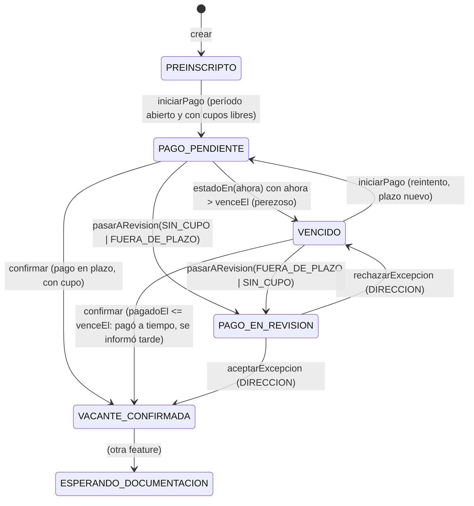

# Data Model: Postulación con plazo de pago y control de cupos

**Spec**: [spec.md](spec.md) | **Research**: [research.md](research.md)

Dos vistas del mismo modelo: el **dominio** (`packages/domain`, sin dependencias) y el **esquema** (Supabase,
detrás del adaptador). El adaptador mapea uno a otro, y los tipos generados por Supabase no salen de
`packages/infrastructure` (Principio I).

## 1. Dominio

### Value objects

| Nombre | Representa | Reglas |
|---|---|---|
| `Monto` | dinero en centavos enteros | entero ≥ 0; no hay `float` en ningún punto; `cubre(otro)` |
| `Dni` | documento del aspirante | solo dígitos y largo válido (la normalización, por ejemplo quitar puntos, se hace en el borde) |
| `NumeroDePostulacion` | ID legible para la ventanilla | entero > 0; `formatear()` lo devuelve con ceros a la izquierda (6 dígitos) |
| `ReferenciaDePago` | `proveedor` + `referenciaExterna` | el par identifica un pago de forma única (idempotencia) |

### Entidades

**PeriodoDeIngreso**
- `id`, `institucionId`, `nombre`, `totalCupos` (entero ≥ 0), `cierraEl` (fecha), `diasPlazoPago` (entero > 0),
  `montoMatricula: Monto` (> 0).
- `estaAbierto(ahora)`: `ahora <= cierraEl`.
- `calcularVencimiento(ahora)`: `min(ahora + diasPlazoPago, cierraEl)`.
- Regla: `totalCupos` no puede bajar por debajo de las vacantes ya confirmadas (lo verifica el caso de uso
  `ModificarPeriodo` con la ocupación actual).

**Postulacion** (raíz de agregado)
- `id`, `numero: NumeroDePostulacion`, `aspiranteId`, `periodoId`, `estado`, `venceEl?` (solo en
  `PAGO_PENDIENTE`), `motivoRevision?` (solo en `PAGO_EN_REVISION`).
- Es inmutable: cada transición devuelve una Postulación nueva o lanza `TransicionInvalida`.

**Pago**
- `id`, `referencia: ReferenciaDePago`, `monto: Monto` (> 0), `pagadoEl`, `registradoEl`, `estado`,
  `motivoRevision?` (si está `A_DECIDIR`), `motivoNoImputado?` (si está `NO_IMPUTADO`), `postulacionId?`,
  `cargaId?`, `dniInformado?`, `numeroInformado?`.

**CargaDeInforme**
- `id`, `institucionId`, `cargadaPor` (perfil `TESORERIA`), `cargadaEl`, `nombreArchivo`, y el resumen:
  `acreditados`, `aDecidir`, `noImputados`, `duplicados`.

**DecisionDeDireccion**
- `id`, `pagoId`, `decision` (`ACEPTAR` | `RECHAZAR`), `decididaPor` (perfil `DIRECCION`), `decididaEl`,
  `comentario?`.

**Perfil**
- `id` (el de Auth), `institucionId`, `nombre`, `apellido`, `email`, `dni`, `cuil`, `fechaNacimiento`, `sexo`,
  `telefono?`, `direccion?`, `rol`, `verificado`. **Sin contraseña**: la maneja Supabase Auth (hoy `User` tiene
  `password`, y hay que sacarlo).

### Máquina de estados de la Postulación



Los estados `ESPERANDO_DOCUMENTACION`, `DOCUMENTACION_EN_REVISION`, `OBSERVADO`, `DOCUMENTACION_VALIDADA` y
`CONFIRMADO_PARA_EXPORTAR` existen en el enum, pero sus transiciones quedan fuera de esta feature (research R9).
Para la ocupación cuentan `VACANTE_CONFIRMADA` **y todos los posteriores**.

`PAGO_EN_REVISION` **no vence** (FR-013).

### Evaluación de un pago informado (regla del dominio)

`evaluarPago(pagoInformado, imputacion, periodo, ocupados)` devuelve **una** de estas decisiones. `imputacion` es
`{ via: 'NUMERO' | 'DNI', candidatas }`: por dónde buscó el caso de uso y **todas** las Postulaciones que encontró,
cada una con el DNI de su aspirante (la Postulación no lo guarda). Hacen falta las dos cosas: la lista, para la regla
1 ("más de una"), y la vía con el DNI, para la regla 2. Las reglas se evalúan en este orden:

| # | Condición | Decisión | Pago queda |
|---|---|---|---|
| 1 | No hay Postulación candidata (ni por número ni por DNI), o hay más de una | `NO_IMPUTAR(REFERENCIA_DESCONOCIDA \| AMBIGUA)` | `NO_IMPUTADO` |
| 2 | Vino por número y el DNI informado no coincide | `NO_IMPUTAR(DNI_NO_COINCIDE)` | `NO_IMPUTADO` |
| 3 | `monto < periodo.montoMatricula` | `NO_IMPUTAR(MONTO_INSUFICIENTE)` | `NO_IMPUTADO` |
| 4 | La Postulación ya está en `VACANTE_CONFIRMADA` o posterior, o en `PAGO_EN_REVISION` | `NO_IMPUTAR(YA_TIENE_PAGO)` | `NO_IMPUTADO` (pago doble, para que Tesorería lo devuelva) |
| 5 | La Postulación está en `PREINSCRIPTO` (nunca inició el pago), o en `VENCIDO` sin `venceEl` (migrada de `RECHAZADO`, research R8) | `NO_IMPUTAR(SIN_PAGO_INICIADO)` | `NO_IMPUTADO` |
| 6 | `pagadoEl > venceEl` | `REVISION(FUERA_DE_PLAZO)` | `A_DECIDIR` |
| 7 | `ocupados >= totalCupos` | `REVISION(SIN_CUPO)` | `A_DECIDIR` |
| 8 | Si no se cumple ninguna de las anteriores | `CONFIRMAR` | `ACREDITADO` |

El orden de 6 antes que 7 cubre el caso borde "tardío **y** sin cupo" (se registra `FUERA_DE_PLAZO`).

La regla 7 también alcanza a una Postulación persistida en `VENCIDO` que pagó dentro del plazo y se informó tarde:
la regla 6 no corta, y si ya no hay cupo queda `REVISION(SIN_CUPO)`. Por eso `VENCIDO → PAGO_EN_REVISION` admite
los dos motivos (es lo que ya aceptan `contracts/puertos.md` y `contracts/rpc.md`).

El estado **efectivo** (`estadoEn(ahora)`) no participa de la regla 6: lo único que cuenta es `pagadoEl` contra
`venceEl`. Una Postulación que hoy se ve `VENCIDO`, pero cuyo pago tiene fecha dentro del plazo, se **confirma**
(supuesto de la spec: cuenta la fecha de pago, no la de carga). Por eso existe la transición
`VENCIDO → VACANTE_CONFIRMADA`.

La decisión que se le pasa al puerto lleva el estado **persistido** de la Postulación (el que leyó el repositorio),
no el efectivo (ver contracts/puertos.md, `estadoEsperado`).

Antes de evaluar, la idempotencia: si `ReferenciaDePago` ya existe, el resultado es `DUPLICADO` y no se escribe
nada (SC-002).

### Errores del dominio

`TransicionInvalida`, `PeriodoCerrado`, `SinCuposParaIniciar` (FR-011), `CuposPorDebajoDeConfirmadas` y
`NoAutorizado` (este último lo lanza el caso de uso, no la entidad).

## 2. Esquema (Supabase, PostgreSQL 17)

Convenciones: español, `snake_case`, sin ñ ni tildes, timestamps `creado_el` y `actualizado_el` (`timestamptz`,
`DEFAULT now()`, trigger `actualizar_actualizado_el`). RLS activo en **todas** las tablas.

### Enums

| Enum | Valores |
|---|---|
| `rol_usuario` | `ASPIRANTE`, `SECRETARIA`, `DIRECCION`, `TESORERIA` |
| `sexo` | `M`, `F`, `O` |
| `estado_postulacion` | `PREINSCRIPTO`, `PAGO_PENDIENTE`, `PAGO_EN_REVISION`, `VACANTE_CONFIRMADA`, `VENCIDO`, `ESPERANDO_DOCUMENTACION`, `DOCUMENTACION_EN_REVISION`, `OBSERVADO`, `DOCUMENTACION_VALIDADA`, `CONFIRMADO_PARA_EXPORTAR` |
| `estado_pago` | `ACREDITADO`, `NO_IMPUTADO`, `A_DECIDIR`, `DEVUELTO` |
| `motivo_revision` | `FUERA_DE_PLAZO`, `SIN_CUPO` |
| `motivo_no_imputado` | `REFERENCIA_DESCONOCIDA`, `AMBIGUA`, `DNI_NO_COINCIDE`, `MONTO_INSUFICIENTE`, `YA_TIENE_PAGO`, `SIN_PAGO_INICIADO` |
| `proveedor_pago` | `INFORME_SYSADMIN`, `PAGOS360` |
| `decision_direccion` | `ACEPTAR`, `RECHAZAR` |
| `estado_documento` | `PENDIENTE`, `APROBADO`, `OBSERVADO` |

### Tablas

**instituciones**: `id uuid PK`, `codigo varchar(20) UNIQUE NOT NULL`, `nombre varchar(150) NOT NULL`,
`activa boolean NOT NULL DEFAULT true`, timestamps. Datos de referencia: la migración inserta `FRH` / `UTN FRH`,
porque sin una institución activa no se puede registrar nadie (el seed no corre en el remoto).

**perfiles** (antes `profiles`): `id uuid PK → auth.users ON DELETE CASCADE`,
`institucion_id uuid NOT NULL → instituciones RESTRICT`, `nombre`, `apellido`, `email UNIQUE`, `dni UNIQUE`,
`cuil UNIQUE`, `fecha_nacimiento date`, `sexo`, `telefono?`, `direccion?`,
`rol rol_usuario NOT NULL DEFAULT 'ASPIRANTE'`, `verificado boolean`, timestamps.

**periodos_de_ingreso**: `id uuid PK`, `institucion_id uuid NOT NULL → instituciones`,
`nombre varchar(150) NOT NULL`, `total_cupos int NOT NULL CHECK (>= 0)`, `cierra_el timestamptz NOT NULL`,
`dias_plazo_pago int NOT NULL CHECK (> 0)`, `monto_matricula_centavos bigint NOT NULL CHECK (> 0)`, timestamps.
`UNIQUE (institucion_id, nombre)`.

**postulaciones** (antes `procedures`): `id uuid PK`, `numero bigint GENERATED ALWAYS AS IDENTITY UNIQUE`,
`aspirante_id uuid NOT NULL → perfiles CASCADE` (antes `user_id`), `periodo_id uuid NOT NULL → periodos_de_ingreso
RESTRICT`, `estado estado_postulacion NOT NULL DEFAULT 'PREINSCRIPTO'`, `vence_el timestamptz NULL`,
`motivo_revision motivo_revision NULL`, timestamps.
- `CHECK (estado <> 'PAGO_PENDIENTE' OR vence_el IS NOT NULL)`: toda Postulación pendiente tiene vencimiento.
  `vence_el` se conserva después (en `VENCIDO` o confirmada) para auditoría.
- `CHECK ((estado = 'PAGO_EN_REVISION') = (motivo_revision IS NOT NULL))`.
- Índice único parcial: **una Postulación activa por aspirante y período**, sobre `(aspirante_id, periodo_id)`
  `WHERE estado <> 'VENCIDO'`.
- Índices: `(periodo_id, estado)` para el conteo de ocupación.

**documentos** (antes `documents`): `id`, `postulacion_id → postulaciones CASCADE` (antes `procedure_id`), `ruta`
(antes `rute`), `vigencia` (antes `validity`), `tipo varchar(100)?`,
`estado estado_documento NOT NULL DEFAULT 'PENDIENTE'`, timestamps. **Se elimina `procedure_documents`.**

**cargas_de_informe**: `id`, `institucion_id → instituciones`, `cargada_por uuid → perfiles`,
`cargada_el timestamptz`, `nombre_archivo text`, `acreditados int`, `a_decidir int`, `no_imputados int`,
`duplicados int` (todos `DEFAULT 0` y `CHECK (>= 0)`).

**pagos**: `id`, `proveedor proveedor_pago NOT NULL`, `referencia_externa text NOT NULL`,
`monto_centavos bigint NOT NULL CHECK (> 0)`, `pagado_el timestamptz NOT NULL`,
`registrado_el timestamptz NOT NULL DEFAULT now()`, `estado estado_pago NOT NULL`, `motivo_revision?`,
`motivo_no_imputado?`, `postulacion_id uuid? → postulaciones RESTRICT`, `carga_id uuid? → cargas_de_informe`,
`dni_informado?`, `numero_informado?`, timestamps. `dni_informado` es un dato personal (Ley 25.326): su plazo de
conservación queda atado al `TODO(RETENCION_DATOS)` de la constitución y se registra en el ADR-0006.
- `UNIQUE (proveedor, referencia_externa)`: la idempotencia (FR-006).
- `CHECK`: `ACREDITADO`, `A_DECIDIR` y `DEVUELTO` requieren `postulacion_id`; `A_DECIDIR` requiere
  `motivo_revision`; `NO_IMPUTADO` requiere `motivo_no_imputado`.
- Índices: `(estado)` para las bandejas, y `(postulacion_id)`.

**decisiones_de_direccion**: `id`, `pago_id uuid UNIQUE → pagos RESTRICT` (una decisión por pago),
`decision decision_direccion`, `decidida_por uuid → perfiles`, `decidida_el timestamptz DEFAULT now()`,
`comentario text?`.

### Ocupación (derivada, sin columna)

```text
ocupados(periodo) = count(postulaciones WHERE periodo_id = periodo
                          AND estado IN (VACANTE_CONFIRMADA, ESPERANDO_DOCUMENTACION, DOCUMENTACION_EN_REVISION,
                                         OBSERVADO, DOCUMENTACION_VALIDADA, CONFIRMADO_PARA_EXPORTAR))
```

Puede superar `total_cupos` **solo** por aceptaciones de Dirección (FR-005). Cada vacante en exceso tiene una fila
en `decisiones_de_direccion` (SC-007).

### Mapeo desde el esquema actual

| Hoy | Pasa a |
|---|---|
| `profiles` / `user_id` | `perfiles` / `aspirante_id` |
| `procedures` | `postulaciones` |
| `documents.procedure_id`, `rute`, `validity` | `documentos.postulacion_id`, `ruta`, `vigencia` |
| `procedure_documents` | (se elimina) |
| `procedure_state` / `user_role` / `user_sex` | `estado_postulacion` / `rol_usuario` / `sexo` (mapeo de valores en research R8) |
| `handle_updated_at()` | `actualizar_actualizado_el()` |
